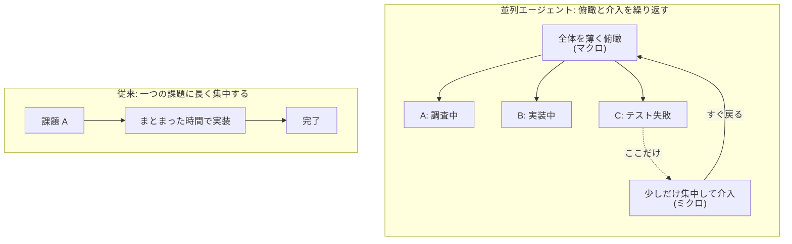
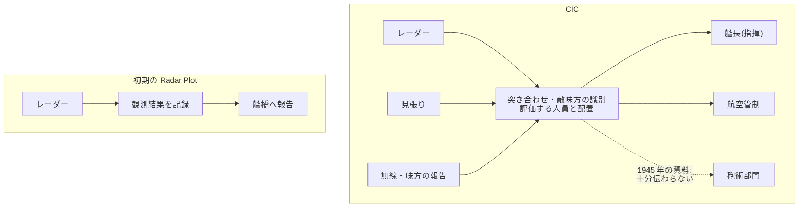
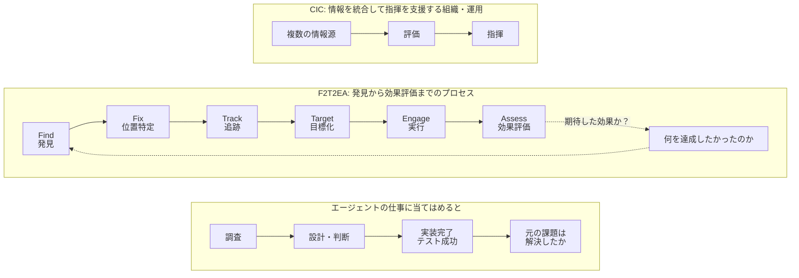
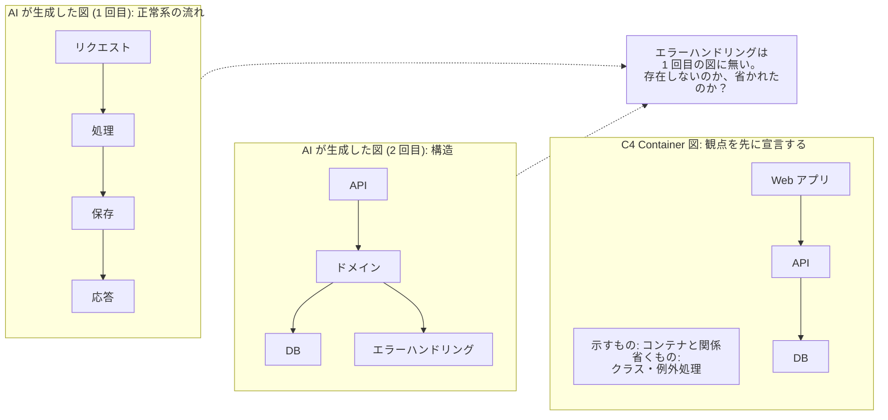
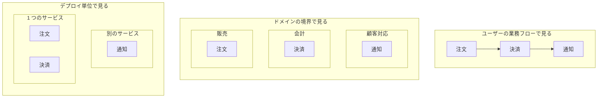

## はじめに

AIエージェントを複数動かしながら仕事をしていると、ほとんど RTS（リアルタイムストラテジー）をプレイしているような感覚になる。

ワシントン航空路管制センター(ARTCC)の管制官。レーダー画面には多数の機影が映り、管制官は必要な機にだけ指示を出す。写真: FAA([Wikimedia Commons](https://commons.wikimedia.org/wiki/File:Air_traffic_controllers_at_the_Washington_ARTCC.jpg))、パブリックドメイン。

従来のソフトウェア開発では、まとまった時間を確保して一つの課題に集中することが重要視されてきた。

しかし、複数の AI エージェントを並列に動かす場合、求められる振る舞いが変わる。

全体を薄く俯瞰しながら、必要なところに少しだけ集中して介入し、すぐに全体へ戻る。それを繰り返す。

RTS でいう **マクロ管理とミクロ操作の切り替え** に近い。

Wikimedia Commons</a>)、GPL v2 以降。|オープンソース RTS「Warzone 2100」の画面(2006 年)。基地の建物と部隊の状態、生産パネルが同時に表示される。画像: Warzone 2100 プロジェクト(<a href="https://commons.wikimedia.org/wiki/File:Warzone_2100_-_bigbase.jpg">Wikimedia Commons</a>)、GPL v2 以降。' onerror="var a=this.dataset.alts.split('|'),c=this.dataset.caps.split('|'),i=+(this.dataset.i||0),n=this.nextElementSibling;if(i&lt;a.length){this.dataset.i=i+1;this.src=a[i];if(n)n.innerHTML=c[i]}else{this.style.display='none';if(n)n.style.display='none'}" />

オープンソース RTS「MegaGlest」の画面。ミニマップ、資源、選択中ユニットの状態、生産の進み具合が同時に表示され、それらを並行して捌く。画像: MegaGlest プロジェクト(<a href="https://commons.wikimedia.org/wiki/File:Screenshot_of_MegaGlest_Gameplay.jpg">Wikimedia Commons</a>)、ゲームのデータは CC BY-SA 3.0。

この図が示すのは、注意の配分が「一本の集中」から「俯瞰と介入の往復」に変わることだけだ。各エージェントの中で何が起きているか、介入から戻ったときに全体が何に変わっているかは省いている。

ただ、これには適性差が大きい。だからといって、長いタスクを委任して完了まで放置する Fire and Forget が万人向けとも思えない。

エージェントが 30 分かけて調査・実装した内容を、今度は人間が短時間で理解し、次のループに入らなければならないからだ。

結果だけ分かればいいわけではない。何を調べ、何を発見し、なぜその設計に至ったのか。可能な限りエージェントと理解を同期したい。

つまり、問題はタスクの管理だけではなく、**複数の主体が並行して活動する中で、どう状況認識を維持するか** にある。

NASA ジョンソン宇宙センターの ISS 飛行管制室(2009 年、STS-128 のドッキング時)。担当者ごとに別の系統をコンソールで見張り、フライトディレクターが全体を見る。写真: NASA / James Blair([Wikimedia Commons](https://commons.wikimedia.org/wiki/File:STS-128_MCC_space_station_flight_control_room.jpg))、パブリックドメイン。

## 戦場の霧と、図面の上の戦争

CIC の話に入る前に、もう少し手前から始めたい。

クラウゼヴィッツは『戦争論』で、戦争において行動の基礎となる事柄の 4 分の 3 は、大なり小なり不確実性の霧の中にある、と書いた。いわゆる **戦場の霧** である。

この霧に対して、指揮官が取れる手は長いあいだ二つしかなかった。自分で見に行くか、誰かに見てきてもらうか。

軍隊が大きくなり、戦線が指揮官の視界を超えると、後者しか残らない。司令部は前線から離れた場所に置かれ、伝令や電話で届く報告をもとに、地図の上に駒を並べる。

つまり司令部が見ているのは戦場ではなく、**報告から組み立てた図面** である。報告は遅れて届き、抜け落ち、ときに間違っている。図面の上では保っているように見える戦線が、実際にはもう崩れていることもある。

この「図面の上でしか分からない」構造を、逆に意図して設計した例が、1940 年の英空軍戦闘機軍団だ。

沿岸のレーダー(Chain Home)の観測は、まず本部の濾過室(Filter Room)で突き合わせられ、確からしい航跡だけが各グループの作戦室へ送られる。内陸に入った敵機は、監視隊の目視報告で追う。作戦室では WAAF(女性補助空軍)のプロッターが、地図台の上で敵味方の編隊を示す駒を動かし続け、指揮官は台を見下ろすバルコニーから、どの飛行隊をどこへ上げるかを決めた。

英空軍第 11 戦闘機群司令部(アクスブリッジ)の作戦室で、地図台の駒を動かす WAAF のプロッター、1942 年。写真: 英空軍省公式写真、帝国戦争博物館 CH 7698([Wikimedia Commons](https://commons.wikimedia.org/wiki/File:WAAF_plotters_at_work_in_the_Operations_Room_at_No._11_Group_HQ_at_Uxbridge_in_Middlesex,_1942._CH7698.jpg))。英国政府の著作権は失効しており、パブリックドメイン。

ここで重要なのは、指揮官が見ているものが、生のレーダー画面ではなく、濾過と記入を経た図面だという点だ。何を駒にし、何を捨てるかは、濾過室の判断である。**台の上に無いものは、指揮官にとって存在しない**。

この仕組みは、霧を消したわけではない。霧の中から「行動に使える像」を組み立てる工程を、人と手順として設計したのだ。

艦の上で同じ問題に直面したのが、次に見る CIC である。

## 戦闘情報センターは何を解決しようとしたのか

この問題を考える上で興味深いのが、軍艦の CIC（Combat Information Center、戦闘情報センター）の歴史だ。

第二次世界大戦初期、米海軍では艦載レーダーの発達によって、従来より遠くの敵艦や航空機を探知できるようになった。

しかし、**情報を取得できることと、その情報を使って適切に行動できることは別だった**。

SG レーダーのコンソール(1945 年)。中央の円い画面が PPI スコープで、ここに映る光点がすべての出発点になる。写真: 米海軍([Wikimedia Commons](https://commons.wikimedia.org/wiki/File:SG_Radar_Console_1945.jpg))、パブリックドメイン。

当初の Radar Plot では、レーダーの観測結果を艦橋に報告したり、目標の位置を記録したりしていた。しかし、複数の情報源を突き合わせ、敵味方の動きを把握し、艦全体の行動につなげる仕組みは十分ではなかった。

1943 年 11 月、ギルバート・マーシャル諸島への攻撃中に、空母レキシントンのプロットルームで作業する戦闘機管制士官 A.F. Fleming 少佐。写真: 米海軍、撮影 Edward Steichen、米国立公文書館 80-G-431069([Wikimedia Commons](https://commons.wikimedia.org/wiki/Category:Aboard_USS_Lexington_(CV-16)))、パブリックドメイン。

_during_WWII.jpg)

軽空母インディペンデンスの CIC(第二次大戦中)。レーダーの画面と記録用の盤が一室に並ぶ。写真: 米海軍([Wikimedia Commons](https://commons.wikimedia.org/wiki/File:CIC_aboard_USS_Independence_(CVL-22)_during_WWII.jpg))、パブリックドメイン。

1942 年のガダルカナル島周辺での戦闘は、こうした問題を浮き彫りにした。

同年 11 月、ニミッツ提督は各艦に情報を収集・分析・評価する Combat Operations Center の設置を指示した。駆逐艦フレッチャーでは、ジョセフ・ワイリーらがレーダー情報をもとに戦況を把握し、艦長や兵器管制へ伝える運用を実践している。

その後、こうした取り組みが CIC として整備されていった。

この図が示すのは、情報源が複数になり、その間に「評価する」工程と出力先ごとの経路が置かれたことだ。艦内の実際の配置、無線の手順、CIC の中での役割分担の細部は省いている。

興味深いのは、問題が単に「表示する情報が足りない」ことではなかった点だ。

センサーから情報が得られていても、組織として状況を理解し、判断に使えなければ意味がない。

そのために、装置だけでなく、**情報を評価する人員、配置、通信経路、指揮との役割分担まで設計する必要があった**。

,_November_1944.jpg)

軽巡洋艦パサデナの CIC(1944 年 11 月 21 日)。中央奥に航空機の状況板が見える。写真: 米海軍([Wikimedia Commons](https://commons.wikimedia.org/wiki/File:Combat_Information_Center_aboard_USS_Pasadena_(CL-65),_November_1944.jpg))、パブリックドメイン。

実際、1945 年の米海軍資料には、CIC が把握していた情報が砲術部門に十分伝わらない問題も記録されている。

CIC を設置すれば自動的に共通の状況認識が生まれるわけではなかった。

ここは AI エージェントとの協業を考える上でも重要だと思う。

複数のエージェントの出力を一つの画面に集めただけでは、各エージェントが発見した事実や判断を、人間が理解していることにはならない。

## F2T2EAはCICとは別の問題から生まれた

もう一つ参考になるのが、F2T2EA という考え方だ。

Find、Fix、Track、Target、Engage、Assess の 6 段階からなる、いわゆる Kill Chain である。

この考え方が注目された背景には、移動する目標に対して、**発見から行動までの時間をいかに短縮するか** という課題があった。

1996 年、米空軍参謀総長のロナルド・フォーグルマンは、地表を移動する対象を発見・位置特定・追跡し、目標として扱えるようになる将来像を語った。

その後、Engage と Assess を含む F2T2EA という表現が広まり、2000 年代には動的目標選定のプロセスとして教義にも組み込まれた。

2026 年の米空軍教義でも、F2T2EA は Dynamic Targeting の手法として位置づけられている。

カタールのアル・ウデイド空軍基地にある統合航空作戦センター(CAOC)、2017 年。動的目標選定を含む航空作戦の指揮統制がここで行われる。写真: 米空軍、Staff Sgt. Alexander W. Riedel([Wikimedia Commons](https://commons.wikimedia.org/wiki/File:Combined_Air_Operations_Center_at_Al_Udeid_Air_Base,_Qatar.jpg))、パブリックドメイン。

ここで CIC と混同してはいけない。

CIC は情報を統合し、状況を把握して指揮を支援するための **組織・運用の仕組み** である。

一方、F2T2EA は、時間的制約のある状況で、発見から効果評価までを進める **プロセス** だ。

この図が示すのは、CIC が「箱」で F2T2EA が「矢印」であること、そして Assess が実行の完了ではなく元の目的に戻る工程であることだ。各段階の所要時間や、どの段階で人が判断するかは省いている。

AI エージェントの仕事にも、発見・判断・実行・評価を高速に繰り返すという共通点はある。

ただし、あらゆるソフトウェア開発が時間制約の厳しい目標選定と同じ構造を持つわけではない。

長期的な設計や探索的な調査には、そもそも急いでループを閉じない方がいい場面もある。

それでも参考になるのは、最後の Assess だ。

**実行が完了したことと、期待した効果が得られたことは違う**。

エージェントが実装を完了し、テストが成功しても、元の課題が解決されたとは限らない。

実行速度を上げるだけでなく、何を達成したかったのかに立ち返る必要がある。

## AIが生成する「わかりやすいHTML」への違和感

最近は、複雑なシステムや調査結果を AI に HTML として可視化させ、理解するアプローチをよく見かける。

便利なのは分かるが、個人的にはあまり好きではない。

理由は情報が削ぎ落とされること自体ではない。

**何を削ぎ落とすかが、毎回変わること** だ。

あるときは正常系を中心に説明し、別のときは構造を中心に説明する。エラーハンドリングや境界条件が、ある図では登場し、別の図では消える。

もちろん、それぞれの説明が間違っているとは限らない。

問題は、図に描かれていないものが、本当に存在しないのか、今回の説明では省略されただけなのか、判断できないことだ。

この図が示すのは、同じシステムでも生成のたびに省かれるものが変わること、そして C4 は省くものを先に宣言することだ。例のシステムは架空で、中身は何も表していない。

人類は以前から、この問題に取り組んできた。

ソフトウェア工学でいう UML や C4 モデルも、その一例だ。

例えば C4 の Container 図では、システムの主要な構成要素や関係を見る。個々のクラスや例外処理を網羅することは目的ではない。

こうしたモデルの価値は、単に情報を簡略化することではなく、**何を表現するためのモデルなのか、読み手と書き手が共通認識を持てること** にある。

もっとも、UML や C4 を使えば網羅性が保証されるわけでもない。どちらも現実そのものではなく、特定の観点から作られたモデルに過ぎない。

ただ、少なくともその観点を明示できる。

これが毎回自由に生成される可視化と大きく違うところだと思う。

## 自分がどのパラダイムにいるか

結局のところ、抽象化なしに複雑なシステムを理解することは難しい。

問題は抽象化そのものではなく、**自分が今、どの抽象化を通して対象を見ているのかを自覚できなくなること** だ。

同じソフトウェアでも、デプロイ単位、ドメインの境界、実行時の依存関係、ユーザーの業務フローでは、まったく違う姿になる。

あるモデルでは重要な境界が、別のモデルでは存在しないかのように見えることもある。

この図が示すのは、同じ 3 つの機能がモデルごとに違う境界で切られることだ。注文と決済の間の境界は、デプロイ単位では無く、ドメインでは有り、業務フローではそもそも境界という概念が無い。実行時の依存関係というもう一つのモデルと、データの所在は省いている。

そして厄介なのは、一つのモデルを通して得た理解を、無自覚に別のモデルへ持ち込んでしまうことだ。

AI による説明や可視化が自然で分かりやすくなるほど、むしろこの危険性は増すのではないかと思っている。

CIC や F2T2EA を AI エージェントの仕事に当てはめること自体も、まさに一つの抽象化だ。

軍事的な指揮統制とソフトウェア開発には共通する問題もあるが、目的も制約も違う。

RTS という比喩も同様で、注意の配分を考えるには便利だが、開発という仕事のすべてを説明できるわけではない。

だからこそ、こうした比喩やモデルの有効範囲を意識しておきたい。

## 欲しいのは、きれいな画面だけではない

AI エージェントのインターフェースを考えるとき、万人に共通する正解はおそらくない。

常に全体を俯瞰したい人もいれば、必要なときだけ詳細を読みたい人もいる。途中の判断に参加することで理解を維持する人もいれば、まとまった成果を読み解くことが得意な人もいる。

自分自身、できる限りエージェントと理解を同期していたいが、すべての情報を常時把握することが現実的だとも思わない。

重要なのは、情報をいくら表示するかではなく、**何を見ているのか、何を見ていないのかを理解できること**。そして、必要なときには別の観点や元の情報に戻れることだ。

AI が生産する情報量は、今後も増えていくだろう。

その中で必要になるのは、ただ処理速度を上げることでも、すべてを分かりやすく要約することでもない。

自分がどのパラダイムから世界を見ているのかを自覚し、必要に応じてその外側へ出られること。

それが、AI エージェントと一緒に仕事を進めながら、自分自身も理解の主体であり続けるために必要な能力なのだと思う。

## 参考資料

- [Carl von Clausewitz, On War, Book I Chapter 3 — Project Gutenberg (Graham 訳)](https://www.gutenberg.org/ebooks/1946)
- [Experimenting with the CIC — U.S. Naval Institute Proceedings (2021)](https://www.usni.org/magazines/proceedings/2021/june/experimenting-cic)
- [CIC Yesterday and Today — Naval History and Heritage Command (1945)](https://www.history.navy.mil/research/library/online-reading-room/title-list-alphabetically/c/cic-combat-information-center-yesterday-today.html)
- [Target Information From CIC — Naval History and Heritage Command (1945)](https://www.history.navy.mil/research/library/online-reading-room/title-list-alphabetically/t/target-information-from-cic-combat-information-center.html)
- [Find, Fix, Track, Target, Engage, Assess — Air & Space Forces Magazine (2000)](https://www.airandspaceforces.com/article/0700find/)
- [AFDP 3-60 Targeting — U.S. Air Force (2026)](https://www.doctrine.af.mil/Portals/61/documents/AFDP_3-60/3-60-AFDP-TARGETING.pdf)
- [C4 Model — FAQ](https://c4model.com/faq)
