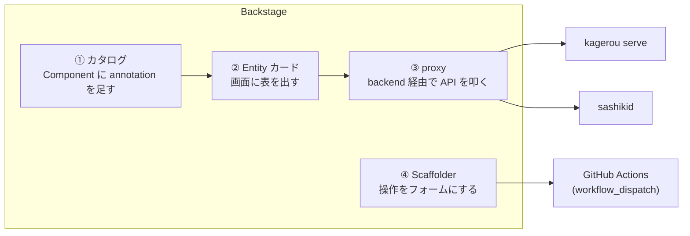

## はじめに

[Backstage](https://backstage.io) は Spotify 製の開発者ポータルです。サービスのカタログ、
ドキュメント、CI の状態などを 1 画面に集めるもので、公式・コミュニティのプラグインが
たくさんあります。

ただ、**自分で作った社内ツールを載せたい**ときに何をすればいいかは、意外と分かりづらい。
ドキュメントは「プラグインを作る」から始まりますが、ちょっとした一覧を 1 枚出したいだけで
プラグイン一式を作るのは重い。

そこで、自作の CLI ツール 2 つを題材に実際に組み込んでみました。

- [kagerou](/blog/kagerou-ephemeral-environments/): PR を開くとプレビュー環境を作り、閉じると消す
- [sashiki](/blog/db-branch-sashiki-oss/): 本物データ入りの DB をブランチとして切り出す

やりたいことは単純で、**サービスの画面を開いたら「いま動いている PR 環境」と「その DB ブランチ」が
並んで見えて、新しい環境を作るボタンがある**。これだけです。

結果から言うと、Backstage の拡張点は 4 つで足り、本体には手を入れず、
自分で書いたのは 600 行弱でした。この記事はその手順と、決めたこと、動かして分かった罠の記録です。

## 組み込む前に: ツール側に HTTP の口が要る

Backstage は Web アプリなので、CLI を直接は呼べません。自作ツール側に **HTTP で読める口**が必要です。

- kagerou には `kagerou serve` という読み取り専用の HTTP サーバーがあります。`GET /environments` で
  環境一覧を JSON で返します
- sashiki はもともとデーモン(`sashikid`)で、`GET /v1/branches` でブランチ一覧を返します

ツールが CLI だけなら、まずここを作ることになります。読み取りだけで構いません。
書込は後述のとおり別の経路にしたからです。

## Backstage の拡張点は 4 つ

今回使ったのはこの 4 つです。



| 拡張点 | 役割 | 書いたもの |
|---|---|---|
| ① カタログ | 「このサービスは kagerou のどのプロジェクトか」を紐付ける | YAML の annotation 2 行 |
| ② Entity カード | サービスの Overview に一覧を出す | React 180〜280 行 × 2 枚 |
| ③ proxy | フロントから自作ツールの API を叩けるようにする | app-config に 10 行 |
| ④ Scaffolder | 「環境を作る」をフォームとボタンにする | テンプレート YAML 48 行 |

順に見ていきます。

## ① カタログ: annotation で紐付ける

Backstage のカタログは、サービスを `Component` という Entity として YAML で登録します。
自作ツールとの紐付けには **annotation** を使います。任意のキーと値を Entity に付けられる仕組みで、
GitHub 連携プラグインも `github.com/project-slug` という annotation でリポジトリを特定しています。

同じ流儀で、自作ツール用のキーを 2 つ決めました。

```yaml
apiVersion: backstage.io/v1alpha1
kind: Component
metadata:
  name: spa-demo
  annotations:
    github.com/project-slug: rikukadev/kagerou-spa-demo
    kagerou.dev/project: spa-demo          # kagerou のプロジェクト名
    sashiki.dev/baseline: rikukadev/todo   # この DB ブランチの元リポジトリ
spec:
  type: website
  owner: guests
```

annotation に持たせるのは**「どのプロジェクトか」という所属情報だけ**です。
API の URL はここに書きません。理由は後述します。

## ② Entity カード: Overview に表を 1 枚足す

ここが本体です。Backstage には新旧 2 つのフロントエンドの仕組みがあり、
今回は**新フロントエンドシステム**(Backstage 1.54)を使いました。

新システムでは `EntityCardBlueprint` という部品で「この条件の Entity に、このカードを出す」を宣言します。
登録部分はこれで全部です。

```tsx
import { createFrontendModule } from '@backstage/frontend-plugin-api';
import { EntityCardBlueprint } from '@backstage/plugin-catalog-react/alpha';

const kagerouEnvironmentsCard = EntityCardBlueprint.make({
  name: 'kagerou-environments',
  params: {
    // annotation を持つ Entity にだけ出す
    filter: entity =>
      Boolean(entity.metadata.annotations?.['kagerou.dev/project']),
    // カード本体は必要になってから読み込む
    loader: () =>
      import('./KagerouEnvironmentsCard').then(m => (
        <m.KagerouEnvironmentsCard />
      )),
  },
});

export const kagerouModule = createFrontendModule({
  pluginId: 'catalog',             // catalog プラグインへの「モジュール」として足す
  extensions: [kagerouEnvironmentsCard],
});
```

そして `App.tsx` の `features` に `kagerouModule` を 1 行足すだけです。

旧システムだと、Overview タブの JSX(`EntityLayout` と `EntitySwitch` の入れ子)を
自分で書き換える必要がありました。新システムでは**画面定義を触らずに**、
モジュールを 1 つ足せばカードが出ます。カードを増やすときの差が大きいので、
これから始めるなら新システムを選ぶのがよいと思います。

カード本体は普通の React です。annotation の値を読んで API を叩き、表にします。

```tsx
export const KagerouEnvironmentsCard = () => {
  const { entity } = useEntity();                    // いま開いている Entity
  const project = entity.metadata.annotations?.['kagerou.dev/project'];
  const discovery = useApi(discoveryApiRef);
  const { fetch } = useApi(fetchApiRef);

  useEffect(() => {
    const load = async () => {
      const base = await discovery.getBaseUrl('proxy');   // ③ の proxy の URL
      const res = await fetch(`${base}/kagerou/environments?project=${project}`);
      setEnvs(await res.json());
    };
    load();
    const timer = setInterval(load, 15_000);            // 環境は生き死にするので軽くポーリング
    return () => clearInterval(timer);
  }, [project]);

  return (
    <InfoCard title="Preview environments">
      <Table columns={columns} data={envs ?? []} />   {/* Name / State / URL / 残り時間 / Owner */}
    </InfoCard>
  );
};
```

`InfoCard`、`Table`、状態の色チップ(`StatusOK` など)は Backstage の部品をそのまま使えるので、
見た目を自分で作る必要はありません。sashiki のカードも同じ形で、列が
Branch / State / 接続コマンド / 残り時間 / Owner になるだけです。

## ③ proxy: フロントから自作ツールの API を叩く

フロントのカードが `kagerou serve` を直接叩くと、CORS と認証の問題が出ます。
Backstage には **proxy プラグイン**が標準で入っていて、backend 経由で任意の HTTP に転送できます。

```yaml
# app-config.yaml
proxy:
  endpoints:
    '/kagerou':
      target: ${KAGEROU_SERVE_URL}
      allowedMethods: ['GET']
    '/sashiki':
      target: ${SASHIKI_API_URL}
      allowedMethods: ['GET']
      headers:
        Authorization: 'Bearer ${SASHIKI_API_TOKEN}'
```

これでフロントからは `/api/proxy/kagerou/environments` を叩けば serve に届きます。
sashiki の API トークンは backend の設定にだけあり、ブラウザには渡りません。

カード側で参照する設定値(proxy のパスなど)は `config.d.ts` に書いて
`@visibility frontend` を付けます。これを忘れると backend は値を持っていてもフロントに配られず、
「設定したのに undefined」になります。最初ここで迷いました。

## ④ Scaffolder: 「環境を作る」をフォームにする

一覧が出たら、次は操作です。Backstage の **Scaffolder** は、もともと「新しいサービスの雛形を作る」
機能ですが、中身は「フォームを出して、宣言したステップを実行する」汎用の仕組みです。

「環境名を入力して up / down を選ぶ」フォームを作り、ステップは標準の
`github:actions:dispatch` 1 つだけにしました。対象リポジトリの workflow を起動して終わりです。

```yaml
spec:
  parameters:
    - properties:
        repo:   { type: string, enum: [kagerou-pub-demo, kagerou-sub-demo] }
        name:   { type: string, pattern: '^[a-z]([a-z0-9-]*[a-z0-9])?$' }
        action: { type: string, enum: [up, down], default: up }
  steps:
    - id: dispatch
      action: github:actions:dispatch
      input:
        repoUrl: github.com?owner=rikukadev&repo=${{ parameters.repo }}
        workflowId: kagerou-manual.yml
        workflowInputs:
          name: ${{ parameters.name }}
          action: ${{ parameters.action }}
```

ポータル自身は AWS を触りません。実際に環境を作るのは CI 上の kagerou で、権限も実行履歴も
GitHub Actions 側に残ります。作られた環境は 15 秒以内に ② のカードに現れます。
自作の Scaffolder アクションはゼロでした。

## 決めたこと 3 つ

やってみて、自作ツールを載せるときの線引きとして残したものが 3 つあります。

**1. API の URL は annotation に書かず、app-config に集約する。**
最初は `kagerou.dev/serve-url: http://...` と annotation に書きかけました。
でも「どのプロジェクトか」は Entity の性質で、「API がどこにあるか」はローカル / staging / 本番で
変わる環境の設定です。Entity に書くとカタログの YAML を環境ごとに持つことになる。
annotation は所属だけ、接続先は app-config、と分けました。

**2. ポータルの経路は読み取りだけにする。**
proxy の `allowedMethods: ['GET']` で、カードからは何をしても自作ツールの状態を変えられません。
sashiki の API トークンも、ブランチの読み書きまでの `branches` scope だけを渡し、
任意 SQL を流せる `admin` scope は渡しません。Backstage にログインできる人全員に
その権限を渡すのは、ポータルの認証の強さに対して釣り合わないからです。
sashiki の Web UI へのリンクは proxy を通さず別タブで開き、sashiki 自身の認証に任せました。

**3. 書込は CI を経由する。**
②③ で読み、④ で GitHub Actions を起動する。この形だとポータルは**状態もクレデンシャルも持ちません**。
Backstage が落ちても何も失われず、立て直せば同じ画面が戻ります。

## 動かして分かった罠 2 つ

### yarn start が死に、ポートが残る

この環境では `yarn start`(`backstage-cli repo start`)が使えませんでした。
CLI の親プロセスと backend の子プロセスの間の通信(`DevDataStore.load`)が 10 秒でタイムアウトし、
全プラグインが起動に失敗します。しかも死んだ backend が **:7007 を掴んだまま残り**、
次の起動も 404 を返し続けます。

回避策は、**ビルドした bundle を素の node で動かす**ことでした。

```sh
yarn build:backend
mkdir .run && tar xzf packages/backend/dist/bundle.tar.gz -C .run
cd .run && yarn workspaces focus --production backend
NODE_ENV=development node packages/backend \
  --config ../app-config.yaml --config ../app-config.local.yaml
```

CLI の親が居ないので問題の通信自体が無効になります。開発用の鍵をプロセス内で作るために
`NODE_ENV=development` が要ります。フロントは `yarn workspace app start` 単独で動きました。
別マシンでは再現を確認していないので、この環境固有かもしれません。
ただ「起動しない、しかも次も失敗する」は原因を掴みにくいので、手順ごと残しました。

### 標準 proxy は SigV4 を送れない

ローカルでは全部つながったのですが、**AWS に載せる段で詰まる**ことが分かりました。

`kagerou serve` は Lambda の function URL としてデプロイし、`AuthType: AWS_IAM` で守る想定です。
一覧には PR 番号とプレビュー URL が入るので、素で公開はできません。
ところが標準の proxy プラグインは単なる HTTP 転送で、**AWS の SigV4 署名をしません**。
`headers:` に静的な値は書けますが、署名はリクエストごとにメソッド・パス・時刻から計算するので、
静的には書けないのです。

「VPC の中に閉じればよい」も成立しませんでした。function URL は常にパブリックな
HTTPS エンドポイントで、PrivateLink がありません。

解決は、SigV4 を署名する backend モジュールを足すことです。既製の
`@segment/backstage-plugin-proxy-sigv4-backend` を使えば backend への追加 1 行と設定で済みます。
ローカルで裸の HTTP に繋ぐと動いてしまうので、この種の問題は実機に載せるまで気づけません。

## やってみての感想

Backstage を触るのは 2 度目です。半年前は、カタログの閲覧数ランキングや FAQ、全文検索を
**自作プラグインとして Backstage の中に実装**しました。データは Backstage の DB に溜まり、
機能も Backstage の中にある。結果として更新が止まり、6 月に撤収しました。

今回は逆に、**ツールはツールとして外にあり、Backstage はその一覧を表示する画面と押すボタンだけ**です。
拡張点 4 つのうち、コードを書いたのは Entity カードだけで、あとは YAML です。
Backstage 本体にも、kagerou と sashiki 本体にも手を入れていません。

自作ツールを載せたいときは、プラグインを作る前に「HTTP で読める口 + annotation + カード 1 枚 + proxy」
で足りるかを考えるのがよさそうです。操作は Scaffolder から CI を叩けば、ポータルに権限を持たせずに済みます。

残っているのは、SigV4 の経路を実機で通すことと、本番環境側の一覧を同じ形のカードで隣に並べることです。
リポジトリは [rikukadev/kagerou](https://github.com/rikukadev/kagerou) と
[rikukadev/sashiki](https://github.com/rikukadev/sashiki) です。
