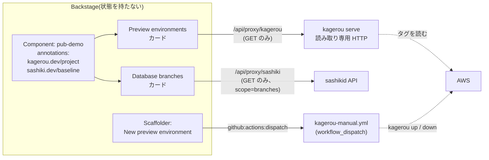

## TL;DR

1. [kagerou](/blog/kagerou-ephemeral-environments/)(PR ごとのプレビュー環境)と
   [sashiki](/blog/db-branch-sashiki-oss/)(DB のブランチ)はコードの依存がなく、
   互いの存在を知らない。**2 つを 1 画面で見る場所**として Backstage を立てた
2. 作ったのは Component の Overview に出る**環境カード 2 枚**と、環境を発行する
   Scaffolder テンプレート 1 枚。合計 600 行弱で、Backstage 本体には手を入れていない
3. 線引きは 3 つ。**annotation には「どのプロジェクトか」だけ**を持たせ、接続先は
   app-config に集約する。**フロントは AWS を知らず**、backend の proxy 経由で
   読み取り専用 API だけを読む。**書込はポータルから直接せず** `workflow_dispatch` を叩く
4. 罠は 2 つ。`yarn start` がこの環境では IPC タイムアウトで全プラグインが起動失敗し、
   死んだ backend が :7007 を掴んだまま残る。もう 1 つは、標準の proxy プラグインが
   SigV4 署名を送れないので、`AuthType: AWS_IAM` の function URL を**既製品だけでは叩けない**

## 動機: 2 つのツールは互いを知らない

kagerou は PR を開くとプレビュー環境を作り、閉じるか TTL が来ると消す CLI です。
sashiki は本物データ入りの DB をブランチとして切り出すデーモンです。
2 つは `github_pr://org/repo/42` という **source の名前規約だけ**で対応づけられていて、
コード上の依存はありません。

この疎結合は設計として正しいのですが、使う側から見ると困ることがひとつあります。
「PR 42 の環境はいま動いているか、その DB ブランチは起きているか」を知るのに、
`kagerou list` と `sashiki list` を別々に叩いて自分で突き合わせることになる。

束ねる場所をどちらのツールにも作らない、と決めてありました
(kagerou の設計文書 §12)。本番環境を扱う姉妹ツールが別に予定されていて、
preview / production / DB をひとつの CLI に同居させると設計判断が全行で逆を向くからです。
束ねるのは**ポータル側の仕事**。そこで Backstage を立てました。



## 作ったもの

Backstage 1.54 の新フロントエンドシステムで、`catalog` プラグインにモジュールを 2 つ足しました。

| 部品 | 行数 | 何をするか |
|---|---|---|
| kagerou モジュール | 26 + 158 | annotation `kagerou.dev/project` を持つ Component の Overview に環境一覧カード |
| sashiki モジュール | 26 + 256 | annotation `sashiki.dev/baseline` を持つ Component の Overview に DB ブランチ一覧カード |
| カタログ | 85 | pub-demo / sub-demo / ecs-demo / spa-demo の Component と System |
| Scaffolder テンプレート | 48 | 名前と up / down を選び、対象リポジトリの workflow を起動する |

カードの登録は `EntityCardBlueprint` で、**どの Entity に出すかを filter、本体を lazy import**にします。
これが 26 行の全部です。

```tsx
const kagerouEnvironmentsCard = EntityCardBlueprint.make({
  name: 'kagerou-environments',
  params: {
    filter: entity =>
      Boolean(entity.metadata.annotations?.[KAGEROU_PROJECT_ANNOTATION]),
    loader: () =>
      import('./KagerouEnvironmentsCard').then(m => (
        <m.KagerouEnvironmentsCard />
      )),
  },
});

export const kagerouModule = createFrontendModule({
  pluginId: 'catalog',
  extensions: [kagerouEnvironmentsCard],
});
```

旧システムの `EntityLayout` / `EntitySwitch` で Overview タブの JSX を書き換える方式と比べると、
**App 側の画面定義を触らずに**、モジュールを `features` に 1 つ足すだけでカードが出ます。
後述の「将来、本番側のカードを並べる」を考えると、この差は大きい。

カード本体は 15 秒ごとに読み取り専用 API を叩いて表に出すだけです。
Name / State(色つき)/ URL / 残り TTL / Owner。環境は生き死にするものなので、
WebSocket などは使わず軽いポーリングにしました。

## 線引き 1: annotation には「所属」だけ、接続先は app-config

最初は annotation に API の URL を書きかけました。`kagerou.dev/serve-url: http://...` のように。
やめた理由は、**それは Entity の属性ではない**からです。

「この Component は kagerou のどのプロジェクトか」は Component 自身の性質です。
一方「その API がどこにあるか」は、ローカル / staging / 本番で変わる環境ごとの設定です。
Entity に書くと、カタログの YAML を環境ごとに持つか、1 つの URL を全環境で共有するかの
どちらかになり、どちらも嫌です。

そこで annotation は所属だけにし、接続先は app-config に集約しました。

```yaml
# catalog/kagerou.yaml — Entity が持つのは所属だけ
annotations:
  kagerou.dev/project: spa-demo
  sashiki.dev/baseline: rikukadev/todo

# app-config.yaml — 接続先はここ(環境ごとに差し替える)
proxy:
  endpoints:
    '/kagerou':
      target: ${KAGEROU_SERVE_URL}
      allowedMethods: ['GET']
    '/sashiki':
      target: ${SASHIKI_API_URL}
      allowedMethods: ['GET']
      headers:
        Authorization: 'Bearer ${SASHIKI_API_TOKEN}'
preview:
  kagerou: { proxyPath: kagerou }
  sashiki: { proxyPath: sashiki, webUrl: ${SASHIKI_WEB_URL} }
```

フロントから読む設定は `config.d.ts` で `@visibility frontend` を宣言します。
これを書かないと、backend は値を持っていてもフロントには配られません。
最初ここを忘れて「設定したのに undefined」で少し迷いました。

## 線引き 2: フロントは AWS を知らない

kagerou の環境一覧は AWS のタグが真実の源ですが、Backstage のフロントが
AWS SDK を持つことはしていません。間に `kagerou serve` という**読み取り専用 HTTP**
(`GET /environments`、`GET /environments/{name}`、`GET /healthz`、それ以外は 405)を挟み、
Backstage の backend の proxy がそこへ転送します。

```ts
const base = await discovery.getBaseUrl('proxy');
const res = await fetch(
  `${base}/${proxyPath}/environments?project=${encodeURIComponent(project)}`,
);
```

proxy の `allowedMethods: ['GET']` は二重の保険です。serve 側も GET 以外を受けませんが、
ポータルの経路でも書込を遮断しておくと、「このカードは何をしても AWS を変更しない」が
設定を読むだけで分かります。

## 線引き 3: sashiki の絞り込みは「名前」ではなく「source」で

sashiki の API は全ブランチを返すので、この Component のものだけに絞る必要があります。
ブランチ名で絞るのが一見楽ですが、やりませんでした。
`pr-42` のような名前は**複数のプロジェクトで衝突する**からです。

絞り込みの鍵は source です。sashiki はブランチ作成時に受け取った source を
opaque な JSON として保存し、**中身を一切解釈しません**。kagerou も同じ契約です。
「誰の PR か」を解釈する責任は上位層にある、というのが両方の設計なので、
Backstage のカードがその上位層になります。

```ts
// source は opaque JSON。中に source_uri を入れる規約
const mine = (data.branches ?? []).filter(b => {
  const uri = sourceURI(b.source);           // github_pr://rikukadev/todo/42
  return uri ? uri.includes(baseline) : false; // annotation の値と突き合わせる
});
```

ここで Component の annotation `sashiki.dev/baseline: rikukadev/todo` が効きます。
「このアプリの DB ブランチ」とは、source がこのリポジトリを指しているブランチのこと。
名前の一致に頼らないので、プロジェクトが増えても壊れません。

## 線引き 4: ポータルのログインで通してよい権限の上限

sashiki の API トークンには `branches` と `admin` の 2 つの scope があります。
proxy に渡すのは **`branches` だけ**にしました。`admin` は任意の SQL を流せるデータブラウザや
hook の手動実行を含み、実質 OS コマンド実行に等しい権限です。
Backstage にログインできる人全員にそこまで渡すのは、ポータルの認証の強さに対して釣り合いません。

同じ理由で、sashiki の Web UI(スキーマ閲覧とクエリ)へのリンクは **proxy を通しません**。
`preview.sashiki.webUrl` に利用者のブラウザから到達できる URL を書き、別タブで開いて
sashiki 自身の認証に委ねます。未設定ならリンク自体を出しません。

接続情報の表示にも 2 つ注意点がありました。

- **パスワードは画面にもクリップボードにも出さない。** 接続コマンドは `mysql -u'dev@pr-42' -p -h ... -P ...` の形で、`-p` は入力を促すだけ
- **ユーザー名の `@` をエスケープする。** sashiki のユーザーは `dev@<branch>` という形なので、
  素朴に `mysql://user@host` と繋ぐと `@` が 2 つになり、クライアントがホストを取り違える。
  URI では `encodeURIComponent` し、コマンドでは `-u` の 1 引数として渡す(区切り文字にならない)

## 書込は workflow_dispatch を叩くだけ

環境を作る・消す操作もポータルから出来るようにしましたが、ポータルが AWS を触ることはしません。
Scaffolder テンプレートが対象リポジトリの `kagerou-manual.yml` を `workflow_dispatch` で起動し、
あとは CI 側の kagerou が従来どおり動きます。

```yaml
steps:
  - id: dispatch
    action: github:actions:dispatch
    input:
      repoUrl: github.com?owner=rikukadev&repo=${{ parameters.repo }}
      workflowId: kagerou-manual.yml
      branchOrTagName: main
      workflowInputs:
        name: ${{ parameters.name }}
        action: ${{ parameters.action }}
```

これでポータルは**状態もクレデンシャルも持ちません**。権限は CI の OIDC ロールに留まり、
監査は GitHub Actions の実行履歴に残ります。作られた環境は 15 秒以内にカードに現れます。
自作の Scaffolder action はゼロで、標準の `github:actions:dispatch` だけで足りました。

## 罠 1: yarn start が IPC タイムアウトで死に、:7007 が残る

この環境では `yarn start`(`backstage-cli repo start`)が使えませんでした。
CLI の親プロセスと backend の子プロセスの間の IPC(`DevDataStore.load`)が 10 秒でタイムアウトし、
全プラグインが起動に失敗します。さらに、死んだ backend の子プロセスが **:7007 を掴んだまま残り**、
以後の起動がすべて 404 を返し続けます。掃除は `lsof -ti :7007 | xargs kill -9` です。

回避策は、**bundle を素の node で動かす**ことでした。

```sh
yarn build:backend
rm -rf .run && mkdir .run && tar xzf packages/backend/dist/bundle.tar.gz -C .run
cd .run && yarn workspaces focus --production backend
NODE_ENV=development node packages/backend \
  --config ../app-config.yaml --config ../app-config.local.yaml
```

CLI の親が居ないので `BACKSTAGE_CLI_CHANNEL` が設定されず、IPC クライアント自体が無効になります。
開発用の鍵はプロセス内生成に切り替わるので `NODE_ENV=development` が必要です。
フロントは `yarn workspace app start` 単独で問題なく動きました。

原因の切り分けはこの環境固有の可能性が高く(別マシンでは再現を確認していません)、
upstream のバグだと主張するつもりはありません。ただ「起動しない、しかも次の起動も失敗する」
という症状は原因を掴みにくいので、手順と一緒に残しました。

## 罠 2: 標準 proxy は SigV4 を送れない

ローカルでは全部つながったのですが、**AWS に載せる段で詰まる**ことが分かりました。

kagerou の契約は、`kagerou serve` を Lambda function URL としてデプロイし、`AuthType: AWS_IAM` で
守ることを推奨しています。一覧には PR 番号とプレビュー URL が入るので、素で公開はできません。
ところが Backstage 標準の proxy プラグインは単なる HTTP 転送で、**SigV4 署名をしません**。
`headers:` に静的な値は書けますが、署名はリクエストごとにメソッド・パス・時刻から計算するので、
静的には書けないのです。

「VPC の中に閉じればよい」も成立しませんでした。調べると function URL は常にパブリックな
HTTPS エンドポイントで、PrivateLink がありません。契約に書いてあった「VPC 内からのみ到達させる」
という選択肢は、この検証で誤りと分かって削除しました。

選択肢は 3 つになります。

| 案 | 内容 | 制約 |
|---|---|---|
| A | SigV4 を署名する backend module を足す | 各ポータルが実装を持つ。既製の `@segment/backstage-plugin-proxy-sigv4-backend` で backend 追加 1 行 + 設定で済む |
| B | `AuthType: NONE` + ネットワークで絞る | function URL は VPC に閉じられないので、実質成立しない |
| C | 前に API Gateway を追加し、API キー等で守る | 固定費のない構成という方針に対して部品が 1 つ増える |

A を正としました。ローカルで裸の HTTP に繋ぐと動いてしまうので、
この種の問題は**実機に載せるまで気づけません**。契約の第一案に既製の実装手段が無い、
というのは契約を書いた時点では検証できていなかったことで、ポータルを実際に組んで初めて出ました。

## 半年前との違い: ポータルに何を持たせるか

Backstage は 2 度目です。半年前に Celsus という名前で、カタログ整備・Google OAuth・
自作プラグイン(エンティティ閲覧数のランキング、FAQ、全文検索、依存グラフ)を作り、
EC2 1 台にデプロイしました。6 月にコスト削減で全部撤収しています。

振り返ると、Celsus は**ポータルにデータと機能を持たせる**方向でした。
閲覧数は Backstage の DB に溜まり、FAQ もそこにある。結果として開発の重心は
Slack の相互レビュー Bot に移り、ポータル本体は更新が止まりました。

今回は逆です。ポータルは**状態を一切持たず、読むか叩くかだけ**。環境の真実は AWS のタグ、
DB ブランチの真実は sashikid、操作の権限と履歴は GitHub Actions にあります。
Backstage が落ちても何も失われず、立て直せば同じ画面が戻ります。
600 行で止められたのは、この割り切りのおかげです。

## まだ無いもの

- **本番側のカード。** 設計文書では Component 1 つに Preview / Production の 2 枚が並ぶ想定で、
  カードは「環境一覧 + データソース差し替え」の形にしてあります。本番側の読み取り API はまだありません
- **SigV4 の経路。** 案 A の参照実装を kagerou 側の `examples/` に追加する予定で、未着手です
- **プラグイン化。** いまはアプリ内のモジュールです。他のポータルでも使えるよう
  別リポジトリのプラグインに切り出すのは、本番カードの形が決まってからにします

同じことをやる人のために、ローカル起動の手順(罠 1 の回避込み)と上の設計判断は
リポジトリの README に残しています。kagerou は
[rikukadev/kagerou](https://github.com/rikukadev/kagerou)、sashiki は
[rikukadev/sashiki](https://github.com/rikukadev/sashiki) です。
