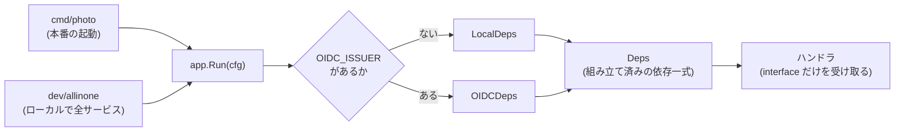
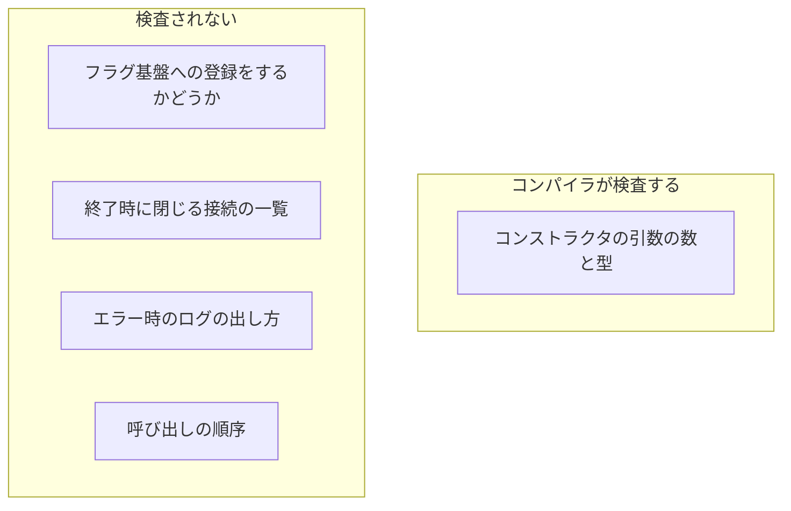
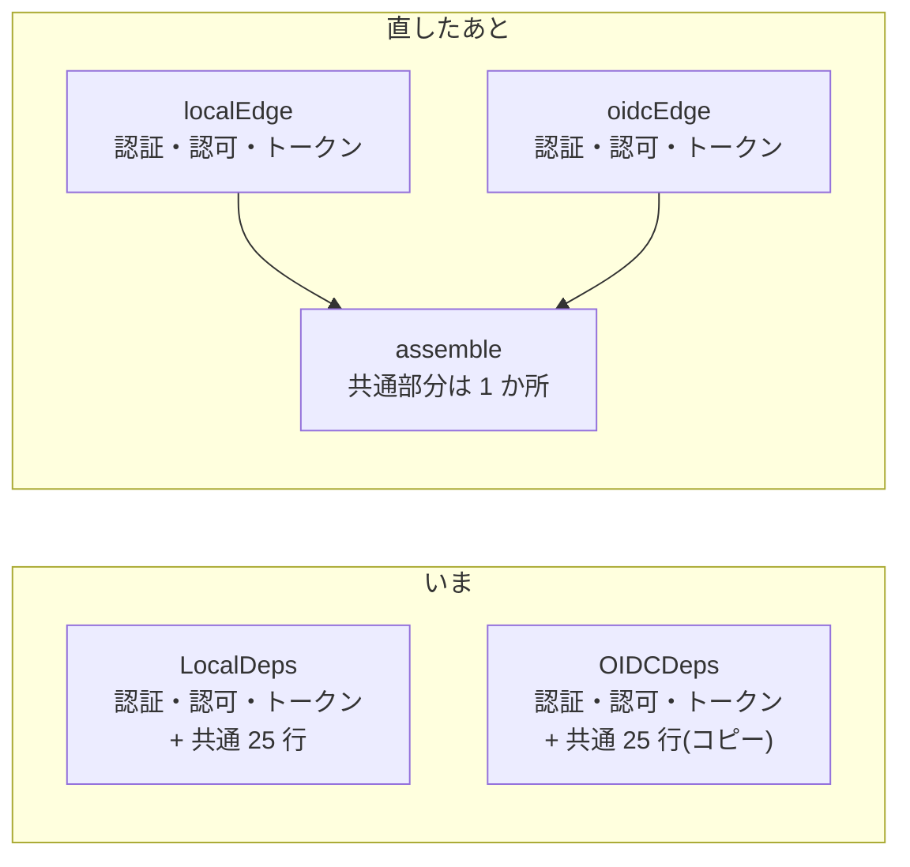
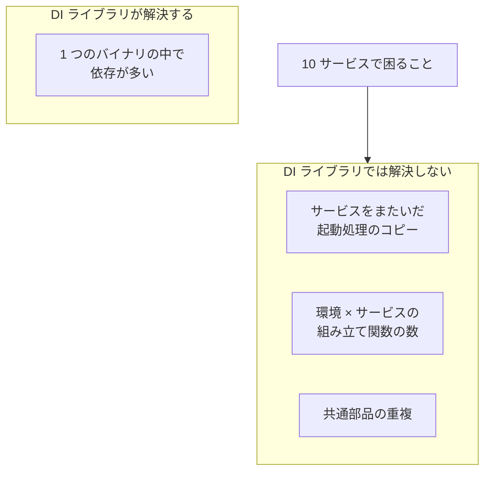
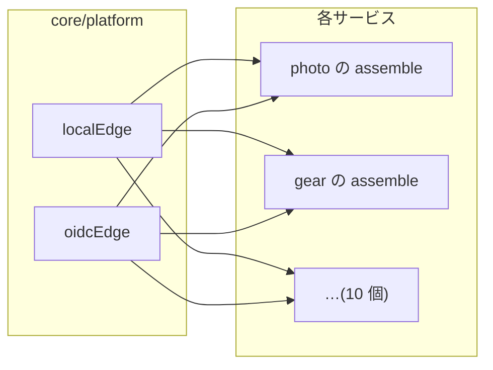
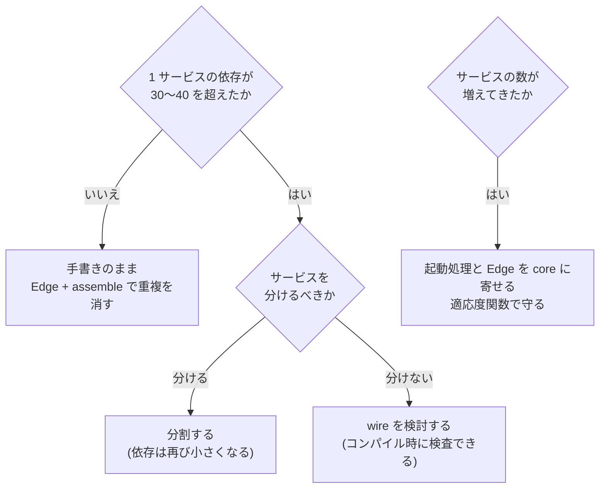

## TL;DR

1. **今の規模なら DI ライブラリは入れない。** 1 サービスの依存は 10 個ほどで、手書きのコンストラクタ注入でもコンパイラが整合を検査してくれる
2. ただし**環境ごとの組み立て関数が 2 つあり、25 行ほどが重複している**。コンパイラが検査するのはコンストラクタの引数までなので、それ以外の重複は環境ごとにずれていく。**変わる部分(`Edge`)と共通の組み立て(`assemble`)に分ける**
3. **10 サービスで困るのは DI ではなく、サービスをまたいだコピー**。実測すると、2 サービスの時点で起動処理の 86% が同じコードだった。これは DI ライブラリの守備範囲の外で、**起動処理と環境の差し替えを core に寄せる**ことで解く
4. DI ライブラリが要るのは **1 つのサービスの中の依存が 30〜40 を超えたとき**。その場合の候補は、コンパイル時に検査できる wire

材料は、マルチサービスのモノレポ構成を検証している [greenfield](/blog/greenfield-overview/) です。

---

## いまの構成

greenfield の各サービスは、**手書きのコンストラクタ注入**で組み立てています。DI ライブラリは使っていません。



決めごとは 3 つです。

- **`services/<name>/app` を合成ルート(composition root)にする。** 具体的な実装パッケージを import してよいのは `app/` と `cmd/*` だけで、それ以外は interface しか知らない
- **組み立て済みの依存を `Deps` 構造体にまとめる。** ハンドラはそこから自分に必要なものだけを受け取る
- **環境ごとに組み立て関数を分ける。** ローカル開発用の `LocalDeps` と、本番相当の `OIDCDeps`

ハンドラには、リスナーごとに必要なものだけを渡しています。

```go
externalv2.Register(ext, externalv2.Deps{Commands: deps.Commands, Queries: deps.Queries})
admin.Register(adm,      admin.Deps{Commands: deps.Commands, Queries: deps.Queries, Assurance: deps.Assurance})
internalapi.Register(intl, internalapi.Deps{Queries: deps.Queries})
```

内部 API には `Queries` しか渡していないので、内部 API から書き込みはできません。**何ができるかを、渡す依存で決めている**形です。

この構成で、「ローカル実装から本番の実装へ差し替えても、usecase とハンドラは変更しなくてよく、変更は配線だけで済む」ことを検証しました。

---

## DI ライブラリの選択肢

Go でよく使われる DI ライブラリは、方式で 2 つに分かれます。

| | 方式 | 配線の誤りが分かる時点 |
|---|---|---|
| **fx / dig**(Uber) | 実行時にリフレクションで依存を解決する | **起動時** |
| **wire**(Google) | 依存の解決コードを生成する | **コンパイル時** |

fx はライフサイクル(起動と停止の順序)の管理まで持っているのが強みです。一方で、何が何に渡されるかはコードを上から読んでも分かりにくく、配線を間違えても**ビルドは成功し、起動して初めて失敗**します。

wire は生成したコードを見れば手書きと同じものが出てくるので読みやすく、誤りもコンパイル時に分かります。代わりに、生成の手順と生成物を管理する手間が増えます。

---

## 今の規模で入れない理由

### 1. 規模に対して得るものが小さい

photo サービスの配線は、コンストラクタの呼び出しが 10 個ほどです。上から読めば全部わかります。DI ライブラリが効いてくるのは、依存が数十を超えて、手で並べること自体が負担になってからです。

### 2. 手書きでもコンパイラが整合を検査している

たとえば `usecase.NewPhotoCommands` に引数を 1 つ足すと、`LocalDeps` と `OIDCDeps` の**両方がコンパイルエラーになります**。「片方だけ直し忘れる」事故の大半は、今の形でもビルドの時点で止まります。

### 3. 誤りを見つける時点を遅らせたくない

greenfield は「規約ではなく構造で守る」「誤りはなるべく早い段階で止める」方針で作っています。fx / dig を入れると、配線の誤りが分かる時点が**ビルドから起動時へ遅れます**。方針と逆の方向です。

wire なら方針とは合いますが、今の規模では、生成の仕組みを持ち込む手間に見合いません。

### 4. 新しいサービスの雛形は scaffold が出す

「手書きだとボイラープレートが増える」という問題は、雛形を生成する scaffold で既に吸収しています。

---

## ただし、組み立て関数は直す

`LocalDeps` と `OIDCDeps` を並べると、**違うのは 3 つだけ**でした。

| | LocalDeps | OIDCDeps |
|---|---|---|
| 認証 | `staticauthn`(固定の開発用) | `oidcauthn`(Keycloak) |
| 認可ストア | `localauthz`(同じ DB) | `authzhttp`(認可サービスへ HTTP) |
| gear へのトークン | 開発用トークン | M2M トークン |

DB 接続、画像ストレージ、フィーチャーフラグの登録、`Commands` と `Queries` の組み立ては、**同じ 25 行ほどが 2 回書かれています**。

### コンパイラが検査する範囲と、しない範囲

先ほど「コンパイラが整合を検査している」と書きましたが、それは**コンストラクタの引数**の話です。それ以外の重複は検査されません。



たとえばフラグ基盤への登録を片方からだけ消しても、ビルドは成功します。片方の環境でだけフラグが既定値になる、という違反が検知されないまま残ります。

これは実際に起きた事故と同じ形です。ローカル開発用の起動経路と本番の起動経路の両方が同じ `app.Run` を呼ぶ形にしていたのに、**その入力の設定を組み立てる経路が 2 つ残っていた**ため、ローカル側だけ DB の接続先が空になり、DB を使うエンドポイントがすべて 500 を返していました。合成ルートを 1 つにしても、入力の組み立てが 2 つあれば同じ事故が起きます。

### 直し方: 変わる部分と共通部分を分ける

環境ごとに変わる部分だけを返す関数と、共通の組み立てを分けます。

```go
// 環境ごとに違うのはここだけ
type Edge struct {
    Authn   authz.Authenticator
    Store   authz.Store
    Gear    *gearlink.Client
    closers []func() error
}

func localEdge(ctx context.Context, cfg Config) (Edge, error) { /* staticauthn, localauthz, 開発用トークン */ }
func oidcEdge(ctx context.Context, cfg Config) (Edge, error)  { /* oidcauthn, authzhttp, M2M トークン */ }

// 共通の組み立ては 1 回だけ書く
func assemble(ctx context.Context, cfg Config, e Edge) (*Deps, error) {
    db, err := openDB(cfg.DSN)
    // 画像ストレージ、フラグ、Commands / Queries ……
}
```



効果は 3 つあります。

- 重複がなくなり、**片方だけ直す事故が構造上起きなくなる**
- 「差し替えの変更は配線だけ」という主張が、**`Edge` の中身だけ**というさらに狭い範囲で成り立つ
- ライブラリを入れなくても、DI ライブラリが提供する「差し替える部分を明示する」効果が得られる

---

## 10 サービスに増えたら

ここからが本題です。サービスが 10 くらいに増えたら DI ライブラリが要るのか、を考えます。

### 実測: 2 サービスの時点で、起動処理の 86% が同じ

photo と gear の `app.go` を比べました。

- **`Run` / `RunWith`**(起動、3 つのリスナー、トレースの初期化、グレースフルシャットダウン)は、サービス名を置き換えて比べると**和集合 93 行のうち 80 行が一致**していた
- `openDB` / `configureDB` / `envOr` / `envIntOr` / `addrOf` / `withCallTimeouts` は、**両方のサービスに同じものがある**

つまり 2 サービスの時点で、**起動まわりの約 150 行がサービスごとにコピーされています**。10 サービスなら 10 部です。

### 増えるもの、増えないもの

| 10 サービスで | 増えるか | DI ライブラリで解決するか |
|---|---|---|
| 1 サービスの中の依存の数 | **増えない**。10〜15 個のまま | — |
| 起動・シャットダウン・トレースの手順 | **10 部のコピーになる** | しない |
| 環境ごとの差し替え(local / OIDC) | **10 × 2 の組み立て関数になる** | しない |
| DB 接続や M2M トークンなどの共通部品 | **10 か所に同じコードが並ぶ** | しない |

ここが一番大事なところです。**DI ライブラリが解決するのは「1 つのバイナリの中の依存が多い」問題で、「サービスの数が多い」問題ではありません。** サービスごとに合成ルートは独立しているので、10 サービスになっても 1 つあたりの依存グラフは小さいままです。



困るのは**サービスをまたいだ重複**です。たとえばトレースの初期化順を直したいとき、10 サービス分を同じように直す必要があり、1 つ漏れてもビルドは成功するので気づけません。

### やること 1: 起動処理を core に寄せる

```go
// core/runtime: 起動・リスナー・トレース・シャットダウンを 1 か所で持つ
runtime.Run(ctx, runtime.Service{
    Name:  "photo",
    Build: func(ctx context.Context, edge platform.Edge) (*Deps, error) { /* assemble */ },
    APIs:  APIs,
})
```

各サービスが書くのは、**自分の依存の組み立てと API の登録だけ**になります。シャットダウンの順序やトレースの初期化を直すときは、core の 1 か所を直せば全サービスに反映されます。

### やること 2: 環境の差し替えも core に寄せる

先ほどの `Edge`(認証・認可・M2M トークン)は、サービスごとではなく **`core/platform` が 1 つだけ持つ**ようにします。



「10 サービス × 2 環境 = 20 個の組み立て関数」が、「**2 つの Edge + 10 個の assemble**」になります。

### やること 3: 構造を検査で守る

core に寄せても、新しく作ったサービスが起動処理をコピーして独自に書き換えれば、また重複が始まります。

greenfield には既に[適応度関数](/blog/evolutionary-architecture-intro/)(アーキテクチャの性質を検査するテスト)があるので、そこに次のような検査を足します。

- 全サービスの `app/` が `runtime.Run` を使っている
- `app/` に `http.Server` を直接書いていない

違反するサービスが出たら CI が失敗します。

---

## それでも DI ライブラリが要るのは

**1 つのサービスの中の依存が 30〜40 を超えたとき**です。たとえば 1 つのサービスが大きくなり、リポジトリや外部クライアントを大量に持つようになった場合です。

その場合も候補は **wire** です。理由は前と同じで、配線の誤りが起動時まで分からない方式は、誤りを早く止める方針と合いません。

ただ、1 つのサービスがそこまで大きくなったら、DI ライブラリの前に**サービスを分けるべきかどうか**を考えることになると思います。依存が多すぎるのは、境界の引き方を見直すべき兆候でもあるからです。



---

## まとめ

| 規模 | やること |
|---|---|
| **今(2 サービス)** | `Edge` + `assemble` で、環境ごとの組み立て関数の重複を消す |
| **5〜10 サービス** | **起動処理と `Edge` を core に寄せる**。適応度関数で構造を守る |
| **1 サービスが巨大化** | wire を検討する。その前に分割を検討する |

- **DI ライブラリは「1 つのバイナリの中の依存が多い」問題を解く。** サービスの数が増える問題は解かない
- 手書きの注入でも、**コンパイラはコンストラクタの引数まで検査している**。検査されないのはそれ以外の重複で、そこは構造で消す
- サービスが増えて困るのは、**起動処理と環境の差し替えのコピー**。実測では 2 サービスの時点で起動処理の 86% が同じだった
- 寄せるなら**今のうち**。2 部のコピーなら比べて揃えるのは簡単だが、10 部になってからだと、どれが正しい版かを決めるところから始めることになる
