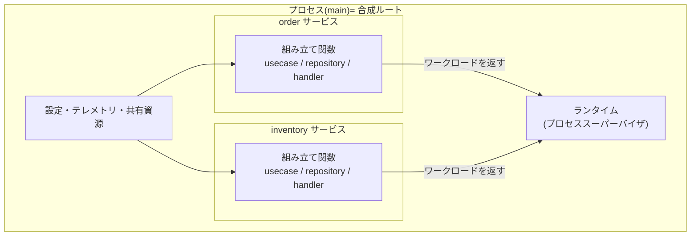
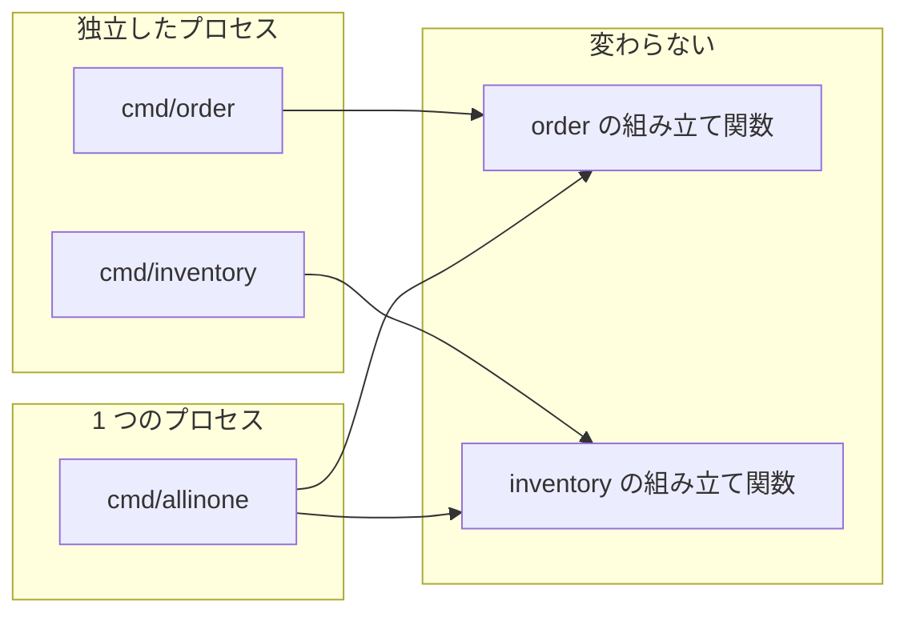
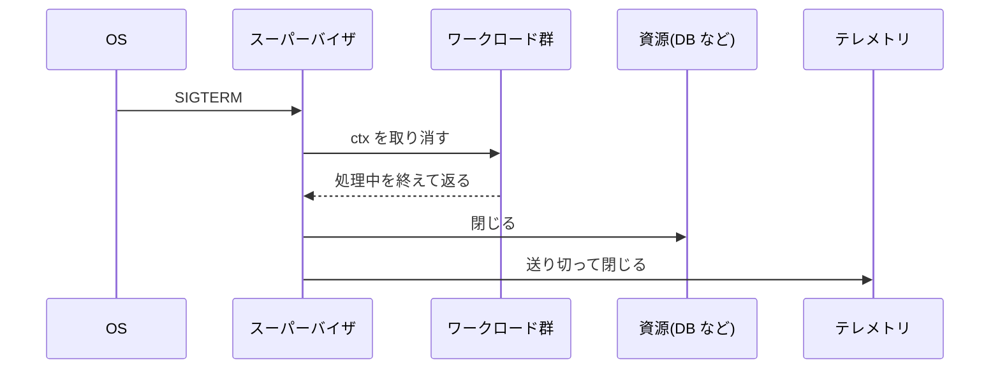
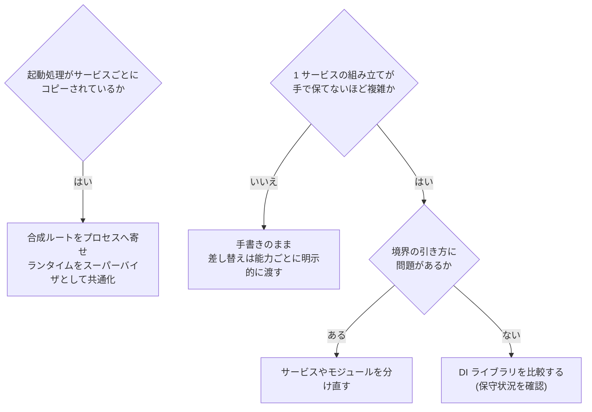

## TL;DR

1. **DI ライブラリを入れるかどうかの前に、責務を分ける。** 依存の組み立て方と、アプリケーションの実行のしかたを分けると、ライブラリが要る場面はかなり減る
2. 分け方は **「プロセスに合成ルート、サービスに組み立て関数、ランタイムにワークロード管理」**。サービスは内部を組み立ててワークロード(HTTP サーバーやコンシューマ)を返すだけで、自分では起動しない
3. ランタイムは**アプリケーションフレームワークではなく、プロセススーパーバイザ**として作る。共通の契約は `Run(ctx) error` だけにして、**HTTP 固有の概念を入れない**
4. ライブラリを入れる判断は**依存の数ではなく、組み立ての複雑さ**で行う。google/wire は 2025 年にアーカイブされているので、入れるなら保守状況を確認する

---

## 前提: DI と合成ルート

DI(依存性注入)は、**使う側が依存を自分で作らず、外から受け取る**ことです。

```go
// DI しない: 使う側が依存を自分で作る
func (s *OrderService) Place(ctx context.Context, o Order) error {
    db := sql.Open("mysql", "user:pass@/orders")  // 中で作っている
    return NewMySQLOrderRepo(db).Save(ctx, o)
}

// DI する: 依存を interface で受け取る
type OrderRepo interface {
    Save(ctx context.Context, o Order) error
}

type OrderService struct{ repo OrderRepo }

func NewOrderService(repo OrderRepo) *OrderService {
    return &OrderService{repo: repo}
}
```

テストでは偽物の `OrderRepo` を渡せますし、本番とローカルで実装を差し替えられます。

依存を組み立てて渡す場所を**合成ルート**(composition root)と呼びます。具体的な実装を知っているのはここだけで、それ以外のコードは interface しか知りません。

```go
func main() {
    db := openDB(os.Getenv("ORDER_DSN"))
    svc := NewOrderService(NewMySQLOrderRepo(db))
    http.ListenAndServe(":8080", NewOrderHandler(svc))
}
```

この「組み立てて渡す」を手で書くか、ライブラリに任せるか、が出発点の問いです。

---

## DI ライブラリの選択肢

Go でよく使われるものは、方式で 2 つに分かれます。

| | 方式 | 配線の誤りが分かる時点 | 保守 |
|---|---|---|---|
| **fx / dig**(Uber) | 実行時にリフレクションで依存を解決する | **起動時** | 保守中 |
| **wire**(Google) | 依存を組み立てるコードを生成する | **コンパイル時** | **2025 年にアーカイブ**(フォークの goforj/wire が保守中) |

fx はコンストラクタを登録しておくと、型を手がかりに組み立ててくれます。起動と停止の順序の管理(ライフサイクル)まで持っていて、`fx.Module` で部品を複数のサービスで共有することもできます。一方で、何が何に渡るかはコードを読んでも分かりにくく、配線を間違えても**ビルドは成功し、起動して初めて失敗**します。

wire は生成されたコードが手書きとほぼ同じなので読みやすく、誤りもコンパイル時に分かります。代わりに生成の手順と生成物を管理する手間が増え、本家は保守が終わっています。

---

## 小さいうちは手で書けばよい

サービス 1 つの組み立てが一直線に読めるうちは、手で書くので十分です。

```go
func buildOrder(cfg Config) (*OrderService, error) {
    db, err := openDB(cfg.DSN)
    if err != nil { return nil, err }
    return NewOrderService(NewMySQLOrderRepo(db), NewRedisCache(cfg.RedisURL), NewPaymentClient(cfg.PaymentURL)), nil
}
```

手書きでも、`NewOrderService` に引数を 1 つ足せば呼んでいる場所が**すべてコンパイルエラー**になります。直し忘れはビルドの時点で止まります。

### ただし、コンパイラが検査するのは引数までだ

ローカルと本番で一部の実装を差し替えるために、組み立て関数を 2 つ書いたとします。

```go
func LocalDeps(cfg Config) (*Deps, error) {
    authn := NewFakeAuthenticator()           // ← 違う
    authz := NewInMemoryAuthorizer()          // ← 違う
    db, err := openDB(cfg.DSN)
    if err != nil { return nil, err }
    registerFlags(cfg.Flags)
    svc := NewOrderService(NewMySQLOrderRepo(db), authz)
    return &Deps{Authn: authn, Orders: svc}, nil
}

func ProdDeps(cfg Config) (*Deps, error) {
    authn := NewOIDCAuthenticator(cfg.Issuer) // ← 違う
    authz := NewAuthzClient(cfg.AuthzURL)     // ← 違う
    db, err := openDB(cfg.DSN)                // ↓ ここから下はローカルと同じ
    if err != nil { return nil, err }
    registerFlags(cfg.Flags)
    svc := NewOrderService(NewMySQLOrderRepo(db), authz)
    return &Deps{Authn: authn, Orders: svc}, nil
}
```

`ProdDeps` からだけ `registerFlags` を消しても、ビルドは成功します。コンパイラが検査するのはコンストラクタの引数の数と型で、**呼ぶかどうか、どの順で呼ぶか、何を閉じるか**は検査されません。重複している部分は、気づかないうちに環境ごとにずれていきます。

### 差し替えは「環境」ではなく「能力」ごとに

この形にはもう 1 つ問題があります。**環境名ひとつで、認証と認可がまとめて切り替わる**ことです。ローカルで本物の OIDC を使いつつ、認可だけ偽物にする、といった組み合わせが作れません。

差し替える能力ごとに実装を選んで、明示的に渡す形にします。

```go
// 差し替え可能な依存を、能力ごとに受け取る
type Dependencies struct {
    DB            *sql.DB
    Authenticator Authenticator
    Authorizer    Authorizer
}

// 共通の組み立ては 1 回だけ書く
func Assemble(deps Dependencies) (*OrderService, error) {
    registerFlags(...)
    return NewOrderService(NewMySQLOrderRepo(deps.DB), deps.Authorizer), nil
}

// 何を渡すかは、呼ぶ側が能力ごとに決める
deps := Dependencies{
    DB:            openDB(cfg.DSN),
    Authenticator: chooseAuthenticator(cfg),  // 設定から個別に選ぶ
    Authorizer:    chooseAuthorizer(cfg),
}
```

重複が消え、「本物の認証 + 偽物の認可」のような組み合わせも作れます。ここまではライブラリなしで済みます。

---

## サービスが増えると、困るのは組み立てではない

サービスが 10 くらいに増えたら、さすがに DI ライブラリが要るのでしょうか。各サービスの `main` を並べてみます。

```go
// order サービス
func main() {
    cfg := ConfigFromEnv()
    tracer := initTracing("order")
    defer tracer.Shutdown()

    svc, err := Assemble(dependenciesFrom(cfg))   // ← ここだけがサービス固有
    if err != nil { log.Fatal(err) }

    srv := &http.Server{Addr: cfg.Addr, Handler: withTracing(routes(svc))}
    go srv.ListenAndServe()
    waitForSignal()
    shutdownGracefully(srv)
}

// inventory サービス — サービス名と Assemble / routes 以外は同じ
```

実際に 2 つのサービスを持つプロジェクトで起動処理を比べると、**サービス名を揃えて 93 行のうち 80 行(86%)が一致**していました。

ここで大事なのは、**サービスが増えても 1 サービスの中の依存は増えない**ことです。増えるのは、トレースの初期化、シグナル処理、グレースフルシャットダウンといった**起動まわりのコピー**です。DI コンテナは 1 つのプロセスの中の依存を組み立てる道具なので、それだけではサービスをまたいだコピーは減りません(fx の `fx.Module` のように、起動・停止の処理まで部品として共有できるものはあります)。

では起動まわりを共通化しよう、となったとき、ここで設計を誤りやすいです。

### 一枚岩の Run を作ると、HTTP に縛られる

素直に共通化すると、こうなりがちです。

```go
// 避けたい形: 共通の起動処理が HTTP を前提にしている
type Service struct {
    Name     string
    Assemble func(Dependencies) (Deps, error)
    Routes   func(Deps) http.Handler     // ← HTTP 固有
}
func Run(s Service) { /* トレース、HTTP サーバー、シャットダウン */ }
```

これだと、HTTP を持たない実行形態が収まりません。キューを読むだけのコンシューマ、定期実行のジョブ、outbox の relay は、`Routes` を返しようがありません。今は HTTP しか無くても、**`Routes` を必須にしないだけで、後から実行形態を足す自由度が大きく変わります。**

---

## 本題: 組み立てと実行を分ける

依存の組み立て方と、アプリケーションの実行のしかたを分けます。

### 3 つの単位

まず、混ざりやすい単位を分けておきます。

| 単位 | 責務 |
|---|---|
| **モジュール** | 内部の依存関係の組み立てと、公開する契約 |
| **サービス** | 提供するワークロードの組み合わせ |
| **プロセス** | 共有する資源、起動・終了の管理 |

DDD のモジュールと、デプロイ単位としてのサービスは、必ずしも一致しません。1 つのサービスが複数のモジュールを束ねることも、モジュールの境界を保ったままデプロイの切り方を変えることもあります。

### 3 つの層

この単位に沿って、責務を 3 層に分けます。

| 層 | 所有者 | 責務 |
|---|---|---|
| **合成ルート** | プロセスのエントリポイント(`main`)。**1 プロセスに 1 つ** | 設定、テレメトリ、共有資源の用意。どのサービスを起動するか。ワークロードの登録 |
| **組み立て関数** | 各サービス | サービス内部を組み立て、**ワークロードを返す**。自分では起動しない |
| **ランタイム** | 共通パッケージ | 登録されたワークロードの起動・停止・グレースフルシャットダウン |



合成ルートの最終的な所有者は**プロセスのエントリポイント**で、サービス側の組み立て関数はその下位にある組み立て(sub-composition)です。

### サービス側: 組み立てて、ワークロードを返す

```go
// services/order/assemble.go
func Assemble(deps Dependencies) (Workloads, error) {
    repo := NewMySQLOrderRepo(deps.DB)
    uc := NewOrderUseCase(repo, deps.Authorizer)

    return Workloads{
        HTTP:     NewOrderHandler(uc),        // HTTP API
        Consumer: NewPaymentEventHandler(uc), // 決済イベントのコンシューマ
    }, nil
}
```

HTTP のハンドラとコンシューマは**同じ usecase を使います**。ドメインのロジックは、どの形で実行されるかから独立します。

### プロセス側: どれを、どう動かすかを決める

```go
// cmd/order/main.go — order だけを独立したプロセスで動かす
func main() {
    proc := bootstrap.Process("order")              // 設定・テレメトリ・シグナル
    order, err := orderapp.Assemble(proc.DependenciesFor("order"))
    if err != nil { log.Fatal(err) }

    runtime.Run(proc.Context(),
        httpserver.New(order.HTTP),
        sqsconsumer.New(order.Consumer),
    )
}
```

```go
// cmd/allinone/main.go — 同じ組み立て関数を、1 つのプロセスにまとめて動かす
func main() {
    proc := bootstrap.Process("allinone")
    order, _ := orderapp.Assemble(proc.DependenciesFor("order"))
    inventory, _ := inventoryapp.Assemble(proc.DependenciesFor("inventory"))

    runtime.Run(proc.Context(),
        httpserver.New(order.HTTP, inventory.HTTP),
        sqsconsumer.New(order.Consumer),
    )
}
```



**独立したプロセスで動かすときも、1 つのプロセスにまとめるときも、サービスの組み立て関数は変わりません。** 違うのはプロセス側だけです。開発中は 1 プロセスでまとめて起動し、本番ではサービスごとにデプロイする、という運用が同じコードでできます。

テレメトリ(トレーサーやメトリクス)は**プロセスに 1 つ**です。組み立て関数には引数で渡し、パッケージ変数では受け渡しません。パッケージ変数で渡すと、「テレメトリを先に初期化しないと DB を開けない」といった順序の依存が、コードの構造に現れなくなります。

### 1 プロセスでも、データの権限は共有しない

ひとつ注意があります。**何を共有するかは、デプロイ形態だけでなくデータの所有権でも決まります。** 1 プロセスにまとめたからといって、全サービスに同じ DB 接続を渡してはいけません。

```go
func (p *Process) DependenciesFor(service string) Dependencies {
    return Dependencies{
        // サービスごとに、そのサービスの資格情報で開く
        DB: openDB(p.cfg.DSN(service)),   // order は order_app、inventory は inventory_app
        Authenticator: p.authn,            // 共有してよい
        Telemetry:     p.telemetry,        // 共有してよい
    }
}
```

order の DB ユーザーには inventory のテーブルへの権限を付けず、inventory も同様にします。1 つのプロセスで動いていても、他のサービスのデータに直接触れられない状態を保てます。

---

## ランタイムはプロセススーパーバイザにする

ランタイムを「アプリケーションフレームワーク」として作ると、ルーティングやハンドラといった概念を抱え込みます。そうではなく、**プロセスの中の実行単位を起動して、止めるだけのもの**(プロセススーパーバイザ)として作ります。

### 契約は Run だけ

```go
type Workload interface {
    Run(ctx context.Context) error
}
```

HTTP サーバーも、SQS のコンシューマも、定期実行のジョブも、この契約を満たせます。

```go
// HTTP サーバーのワークロード
func (h *HTTPServer) Run(ctx context.Context) error {
    errc := make(chan error, 1)
    go func() { errc <- h.srv.ListenAndServe() }()

    select {
    case <-ctx.Done():
        // 停止の合図: 受付を止め、処理中のリクエストを猶予時間内に終える
        shutdownCtx, cancel := context.WithTimeout(context.Background(), h.grace)
        defer cancel()
        return h.srv.Shutdown(shutdownCtx)
    case err := <-errc:
        return err   // 合図の前に止まった = 失敗
    }
}

// コンシューマのワークロード
func (c *Consumer) Run(ctx context.Context) error {
    for {
        msgs, err := c.queue.Receive(ctx)
        if ctx.Err() != nil {
            return nil   // 停止の合図。処理中のメッセージは終えてから返る
        }
        if err != nil {
            return err
        }
        c.handle(ctx, msgs)
    }
}
```

### 終わり方の意味を決めておく

`Run` だけの契約は単純な分、**どう終わったかの意味**を決めておかないと、ワークロードごとに解釈がばらつきます。

| 状況 | ワークロードがすること | スーパーバイザがすること |
|---|---|---|
| 停止の合図(`ctx` の取り消し) | 新しい仕事の受付を止め、処理中を終えて **`nil` を返す** | 全ワークロードが返るのを待つ。全体の上限時間を超えたら待つのをやめる |
| 回復できない失敗 | **エラーを返す** | 他のワークロードも止め、プロセスを異常終了にする |
| 合図の前に返った(`nil` でも) | — | **異常として扱う**。常駐するものが自分から終わるのは想定外 |

停止の順序も決めておきます。



**ワークロードが動いている間に DB を閉じない**、**最後にテレメトリを送り切る**、の 2 つが要点です。逆にすると、処理中のリクエストが DB エラーで失敗したり、停止直前のトレースが失われたりします。

### Start / Stop に分けない理由

`Run(ctx)` は Go の慣習(`errgroup` など)にそのまま乗り、HTTP もコンシューマもこれで表せます。`Start` / `Stop` に分ける必要が出るのは、「HTTP が待ち受けを始めたのを確認してからコンシューマを起動したい」のような**準備完了の通知**が要るときです。そのときも契約を変えず、任意で実装するインターフェース(例: `Ready() <-chan struct{}`)を足せば済みます。

### 1 回で終わる処理は載せない

マイグレーションやバッチのように**1 回で終わる処理**は、常駐するワークロードではありません。スーパーバイザに載せると「合図の前に返った = 異常」と扱われてしまいます。プロセスの合成ルートが直接呼んで、その結果で終了します。

```go
func main() {
    switch os.Args[1] {
    case "migrate":
        os.Exit(exitCode(runMigrate(ctx)))   // 1 回で終わる
    default:
        runtime.Run(ctx, workloads...)       // 常駐する
    }
}
```

---

## 構造を検査で守る

共通の仕組みを作っても、新しいサービスが起動処理をコピーして独自に書き換えれば、また重複が始まります。決まりごとはテストとして実行できる形にします。

このとき、**文字列検索ではなく構文木で調べます**。文字列検索はコメントや文字列リテラルの中にも一致し、書き方を少し変えるだけで見逃します。Go なら `go/parser` と `go/ast` が標準ライブラリにあります。

```go
// 組み立て関数が http.Server を自分で作っていないかを、構文木で調べる
func TestAssemblersDoNotStartServers(t *testing.T) {
    for _, file := range goFilesUnder("services/") {
        f, _ := parser.ParseFile(token.NewFileSet(), file, nil, 0)
        ast.Inspect(f, func(n ast.Node) bool {
            lit, ok := n.(*ast.CompositeLit)
            if !ok {
                return true
            }
            if sel, ok := lit.Type.(*ast.SelectorExpr); ok && sel.Sel.Name == "Server" {
                if pkg, ok := sel.X.(*ast.Ident); ok && pkg.Name == "http" {
                    t.Errorf("%s: 組み立て関数が http.Server を作っている(起動はプロセス側の責務)", file)
                }
            }
            return true
        })
    }
}
```

モジュールの境界そのもの(他のサービスの内部を import できないこと)は、Go のモジュールで構造的に止めるのが確実です。コードの使い方の決まりは、こうした静的な検査で守ります。

---

## で、DI ライブラリはいつ要るのか

ここまで分けると、残るのは**1 つのサービスの組み立て関数の中身**だけです。そこが手で保てなくなったときが、ライブラリを検討するときです。

判断は**依存の数ではなく、組み立ての複雑さ**で行います。依存が 40 個あっても一直線に並ぶだけなら手書きで困りませんし、15 個でも構築の順序や差し替えの条件が入り組んでいれば辛くなります。

次のどれかが手で保てなくなったら、検討を始めます。

- 組み立てコードの変更頻度
- 環境や機能による実装の差し替えの数
- 資源の生成・破棄の順序の複雑さ
- 組み立ての重複
- 依存関係の追跡やテストのしにくさ

検討するときも、まず**責務の分割を見直す**のが先です。組み立て関数が大きすぎるなら、サービスやモジュールの境界の引き方を見直すべき兆候でもあります。それでも配線の負担が残るなら、コード生成型(wire 系)と実行時解決型(fx / dig)を比べます。前者は誤りをコンパイル時に止められ、後者はライフサイクル管理まで持っています。**新規に入れるときは保守状況を確認してください**(google/wire は 2025 年にアーカイブされています)。



---

## まとめ

| 責務 | 持つもの | ポイント |
|---|---|---|
| **合成ルート** | プロセスのエントリポイント(1 プロセスに 1 つ) | 設定・テレメトリ・共有資源。どのサービスを動かすかを決める |
| **組み立て関数** | 各サービス | 内部を組み立ててワークロードを返す。自分では起動しない |
| **ランタイム** | 共通パッケージ | プロセススーパーバイザ。`Run(ctx) error` だけを扱い、HTTP の概念を持たない |

- **DI ライブラリの前に、組み立てと実行を分ける。** 分ければ、独立したプロセスでも 1 つのプロセスでも、同じ組み立て関数がそのまま使える
- **差し替えは環境ではなく能力ごとに。** 環境名ひとつで複数の実装を切り替えると、組み合わせが作れない
- **共通の契約に HTTP 固有の概念を入れない。** `Routes` を必須にしないだけで、後から実行形態を足せる
- **1 プロセスにまとめても、データの権限は共有しない。**
- **ライブラリの判断は依存の数ではなく、組み立ての複雑さで。** 入れるなら保守状況を確認する
