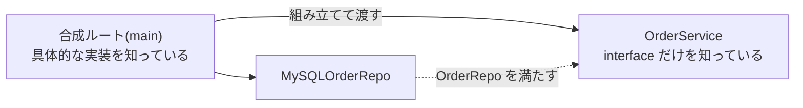
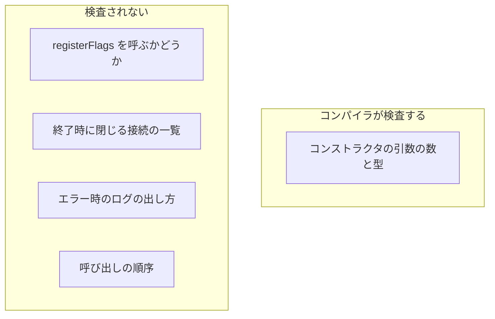
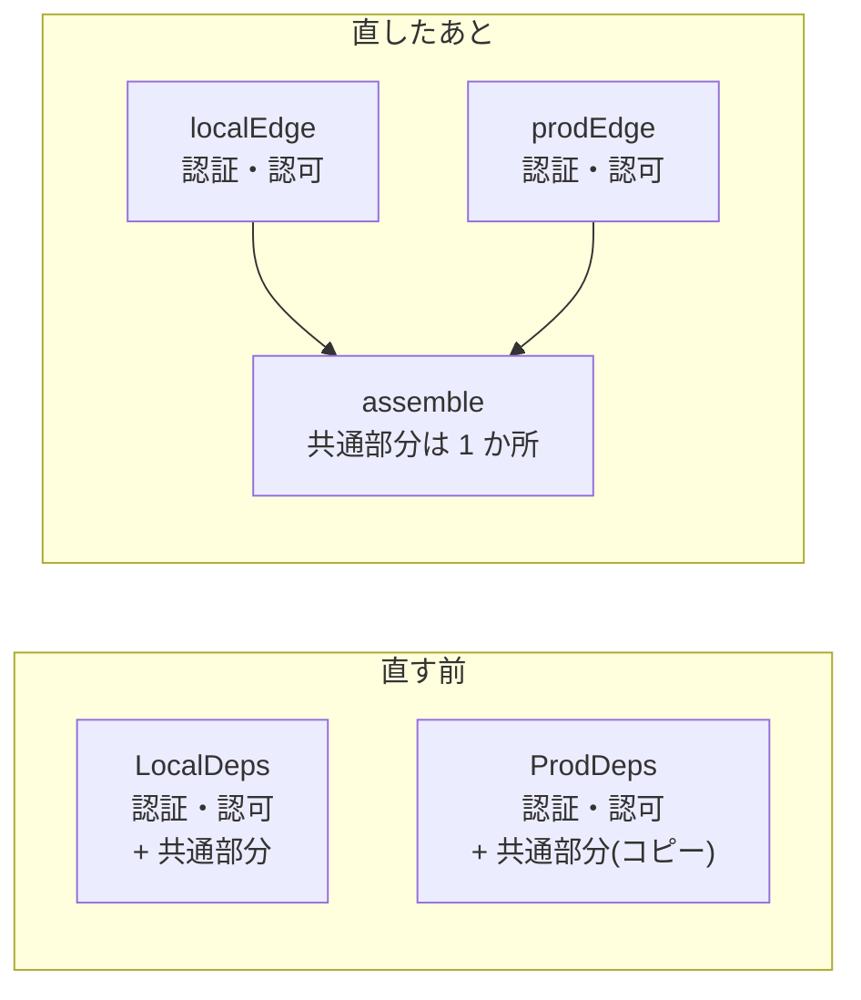
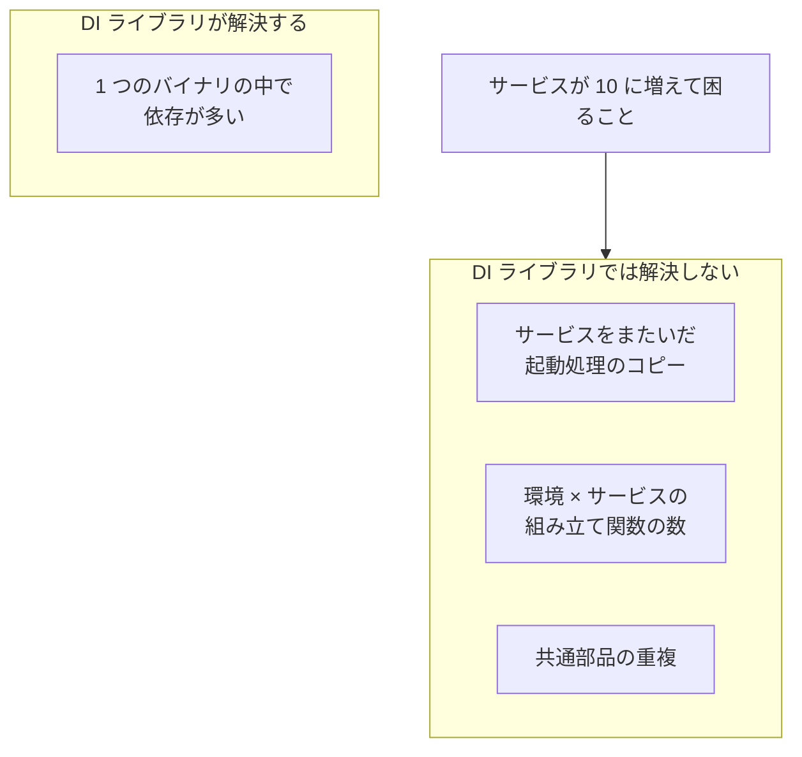
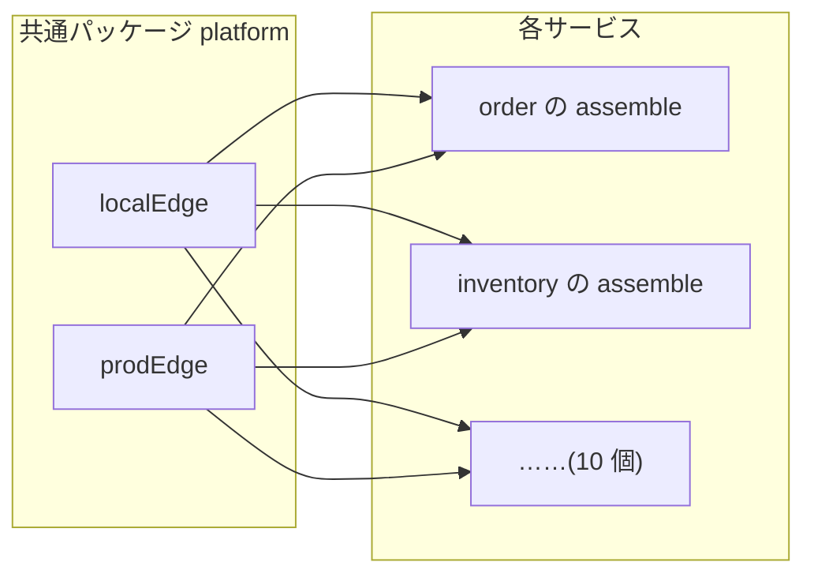
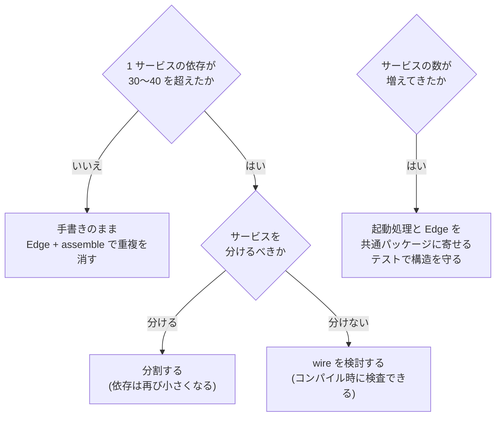

## TL;DR

1. **サービス 1 つの依存が 10〜20 個ほどなら、DI ライブラリは入れなくてよい。** 手書きのコンストラクタ注入でも、コンパイラが整合を検査してくれる
2. ただし**環境ごとの組み立て関数**(ローカル用と本番用など)は重複しやすい。コンパイラが検査するのはコンストラクタの引数までなので、それ以外の重複は環境ごとにずれていく。**変わる部分と共通部分を分けて**重複を消す
3. **サービスが 10 に増えて困るのは DI ではなく、サービスをまたいだコピー**。起動処理や環境の差し替えが、サービスの数だけ複製される。これは DI ライブラリの守備範囲の外で、**共通の起動処理に寄せる**ことで解く
4. DI ライブラリが要るのは **1 つのサービスの中の依存が 30〜40 を超えたとき**。その場合の候補は、コンパイル時に検査できる wire

---

## 前提: DI とは何をすることか

DI(依存性注入)は、**使う側が依存を自分で作らず、外から受け取る**ことです。

```go
// DI しない: 使う側が依存を自分で作る
type OrderService struct{}

func (s *OrderService) Place(ctx context.Context, o Order) error {
    db := sql.Open("mysql", "user:pass@/orders")  // 中で作っている
    repo := NewMySQLOrderRepo(db)
    return repo.Save(ctx, o)
}
```

```go
// DI する: 依存を interface で受け取る
type OrderRepo interface {
    Save(ctx context.Context, o Order) error
}

type OrderService struct {
    repo OrderRepo  // 外から渡される
}

func NewOrderService(repo OrderRepo) *OrderService {
    return &OrderService{repo: repo}
}
```

こうしておくと、テストでは偽物の `OrderRepo` を渡せますし、本番とローカルで実装を差し替えられます。

**誰が依存を組み立てて渡すのか**が次の問題になります。その組み立てる場所を**合成ルート**(composition root)と呼びます。たいていは `main` かその近くに置きます。

```go
// 合成ルート: 具体的な実装を知っているのはここだけ
func main() {
    db := openDB(os.Getenv("DSN"))
    repo := NewMySQLOrderRepo(db)
    svc := NewOrderService(repo)
    handler := NewOrderHandler(svc)
    http.ListenAndServe(":8080", handler)
}
```



この「組み立てて渡す」を**手で書くか、ライブラリに任せるか**が、この記事の論点です。

---

## DI ライブラリの選択肢

Go でよく使われるものは、方式で 2 つに分かれます。

| | 方式 | 配線の誤りが分かる時点 |
|---|---|---|
| **fx / dig**(Uber) | 実行時にリフレクションで依存を解決する | **起動時** |
| **wire**(Google) | 依存を組み立てるコードを生成する | **コンパイル時** |

fx / dig では、コンストラクタを登録しておくと、型を手がかりにライブラリが組み立ててくれます。

```go
// fx のイメージ
fx.New(
    fx.Provide(openDB, NewMySQLOrderRepo, NewOrderService, NewOrderHandler),
    fx.Invoke(startServer),
)
```

並べる順番を気にしなくてよく、起動と停止の順序の管理(ライフサイクル)まで持っています。一方で、何が何に渡るかはコードを読んでも分かりにくく、配線を間違えても**ビルドは成功し、起動して初めて失敗**します。

wire は、組み立てるコードを生成します。生成されたコードは手書きとほぼ同じなので読みやすく、誤りもコンパイル時に分かります。代わりに、生成の手順と生成物を管理する手間が増えます。

---

## 小さいうちは入れなくてよい理由

サービス 1 つの依存が 10〜20 個ほどの段階を考えます。

### 1. 手で並べても読める

```go
func buildDeps(cfg Config) (*Deps, error) {
    db, err := openDB(cfg.DSN)
    if err != nil { return nil, err }
    cache := NewRedisCache(cfg.RedisURL)
    repo := NewMySQLOrderRepo(db)
    payment := NewPaymentClient(cfg.PaymentURL)
    svc := NewOrderService(repo, cache, payment)
    return &Deps{Orders: svc}, nil
}
```

上から読めば、何が何に渡されているか全部わかります。DI ライブラリが効いてくるのは、依存が数十を超えて、並べること自体が負担になってからです。

### 2. 手書きでもコンパイラが整合を検査している

`NewOrderService` に引数を 1 つ足すと、それを呼んでいる場所が**すべてコンパイルエラー**になります。組み立てを複数の場所で書いていても、直し忘れはビルドの時点で止まります。

### 3. 誤りを見つける時点を遅らせない

fx / dig を入れると、配線の誤りが分かる時点が**ビルドから起動時へ遅れます**。誤りはできるだけ早い段階で止めたいので、この段階で入れる理由はありません。

---

## ただし、環境ごとの組み立て関数は重複する

実際のサービスでは、ローカル開発と本番で一部の実装を差し替えることがよくあります。たとえば認証です。

```go
// ローカル: 固定のユーザーで通す
func LocalDeps(cfg Config) (*Deps, error) {
    authn := NewFakeAuthenticator()          // ← 違う
    authz := NewInMemoryAuthorizer()         // ← 違う

    db, err := openDB(cfg.DSN)
    if err != nil { return nil, err }
    cache := NewRedisCache(cfg.RedisURL)
    repo := NewMySQLOrderRepo(db)
    payment := NewPaymentClient(cfg.PaymentURL)
    registerFlags(cfg.Flags)
    svc := NewOrderService(repo, cache, payment, authz)
    return &Deps{Authn: authn, Orders: svc, closers: []func() error{db.Close}}, nil
}

// 本番: OIDC で認証し、認可サービスに問い合わせる
func ProdDeps(cfg Config) (*Deps, error) {
    authn := NewOIDCAuthenticator(cfg.Issuer) // ← 違う
    authz := NewAuthzClient(cfg.AuthzURL)     // ← 違う

    db, err := openDB(cfg.DSN)                // ↓ ここから下はローカルと同じ
    if err != nil { return nil, err }
    cache := NewRedisCache(cfg.RedisURL)
    repo := NewMySQLOrderRepo(db)
    payment := NewPaymentClient(cfg.PaymentURL)
    registerFlags(cfg.Flags)
    svc := NewOrderService(repo, cache, payment, authz)
    return &Deps{Authn: authn, Orders: svc, closers: []func() error{db.Close}}, nil
}
```

違うのは最初の 2 行だけで、**残りは丸ごと同じコードが 2 回書かれています**。

### コンパイラが検査する範囲と、しない範囲

先ほど「コンパイラが整合を検査している」と書きましたが、それは**コンストラクタの引数**の話です。それ以外の重複は検査されません。



たとえば `ProdDeps` からだけ `registerFlags` を消しても、ビルドは成功します。本番でだけフィーチャーフラグが既定値のまま、という違反が検知されないまま残ります。

**組み立てる場所を 1 つにしても、その中に環境ごとの経路が 2 つあれば、同じ種類の事故は起きます。**

### 直し方: 変わる部分と共通部分を分ける

環境ごとに変わる部分だけを返す関数と、共通の組み立てを分けます。

```go
// 環境ごとに違うのはここだけ
type Edge struct {
    Authn Authenticator
    Authz Authorizer
}

func localEdge(cfg Config) (Edge, error) {
    return Edge{Authn: NewFakeAuthenticator(), Authz: NewInMemoryAuthorizer()}, nil
}

func prodEdge(cfg Config) (Edge, error) {
    return Edge{Authn: NewOIDCAuthenticator(cfg.Issuer), Authz: NewAuthzClient(cfg.AuthzURL)}, nil
}

// 共通の組み立ては 1 回だけ書く
func assemble(cfg Config, e Edge) (*Deps, error) {
    db, err := openDB(cfg.DSN)
    if err != nil { return nil, err }
    cache := NewRedisCache(cfg.RedisURL)
    repo := NewMySQLOrderRepo(db)
    payment := NewPaymentClient(cfg.PaymentURL)
    registerFlags(cfg.Flags)
    svc := NewOrderService(repo, cache, payment, e.Authz)
    return &Deps{Authn: e.Authn, Orders: svc, closers: []func() error{db.Close}}, nil
}
```



こうすると、

- 重複がなくなり、**片方だけ直す事故が構造上起きなくなる**
- 環境による違いが **`Edge` の中身だけ**に限定され、読む人にも分かる
- ライブラリを入れなくても、DI ライブラリが提供する「差し替える部分を明示する」効果が得られる

---

## サービスが 10 に増えたら

ここからが本題です。サービスが 10 くらいに増えたら DI ライブラリが要るのかを考えます。

### 各サービスの main は、ほとんど同じになる

サービスが増えると、それぞれの `main` にこういう処理が並びます。

```go
// order サービス
func main() {
    cfg := ConfigFromEnv()
    tracer := initTracing("order")
    defer tracer.Shutdown()

    edge := chooseEdge(cfg)            // local か prod か
    deps, err := assemble(cfg, edge)   // ← ここだけがサービス固有
    if err != nil { log.Fatal(err) }

    srv := &http.Server{Addr: cfg.Addr, Handler: withTracing(routes(deps))}
    go srv.ListenAndServe()

    waitForSignal()
    ctx, cancel := context.WithTimeout(context.Background(), 30*time.Second)
    defer cancel()
    srv.Shutdown(ctx)   // 新しいリクエストを止め、処理中のものを待つ
    deps.Close()        // そのあとで DB などを閉じる
}
```

```go
// inventory サービス
func main() {
    cfg := ConfigFromEnv()
    tracer := initTracing("inventory")   // ← 名前が違うだけ
    defer tracer.Shutdown()

    edge := chooseEdge(cfg)
    deps, err := assemble(cfg, edge)     // ← ここだけがサービス固有
    // …… 以下、order とほぼ同じ
}
```

**サービス固有なのは `assemble` と `routes` だけ**で、トレースの初期化、サーバーの起動、シグナルを待ってのグレースフルシャットダウン、環境の選び方は、サービス名を除いて同じコードになります。

実際に、2 つのサービスを持つ検証用のプロジェクトで起動処理を比べたところ、**サービス名を揃えて比べると 93 行のうち 80 行(86%)が一致**していました。2 つの時点でこれなので、10 個になればこの処理が 10 部できます。

### 増えるもの、増えないもの

| サービスが 10 になると | 増えるか | DI ライブラリで解決するか |
|---|---|---|
| 1 サービスの中の依存の数 | **増えない**。10〜20 個のまま | — |
| 起動・シャットダウン・トレースの手順 | **10 部のコピーになる** | しない |
| 環境ごとの差し替え(local / prod) | **10 × 2 になる** | しない |
| DB 接続などの共通部品 | **10 か所に同じコードが並ぶ** | しない |

ここが一番大事なところです。**DI ライブラリが解決するのは「1 つのバイナリの中の依存が多い」問題で、「サービスの数が多い」問題ではありません。** サービスはそれぞれ別のバイナリで、合成ルートもそれぞれ独立しているので、10 個になっても 1 つあたりの依存は小さいままです。



困るのは**サービスをまたいだ重複**です。たとえばシャットダウンの順序に不具合が見つかったとき、10 サービス分を同じように直す必要があり、1 つ漏れてもビルドは成功するので気づけません。

### やること 1: 起動処理を共通パッケージに寄せる

```go
// 共通パッケージ runtime: 起動・トレース・シャットダウンを 1 か所で持つ
package runtime

type Service struct {
    Name     string
    Assemble func(cfg Config, e platform.Edge) (Deps, error)
    Routes   func(Deps) http.Handler
}

func Run(s Service) {
    cfg := ConfigFromEnv()
    tracer := initTracing(s.Name)
    defer tracer.Shutdown()

    deps, err := s.Assemble(cfg, platform.ChooseEdge(cfg))
    if err != nil { log.Fatal(err) }

    srv := &http.Server{Addr: cfg.Addr, Handler: withTracing(s.Routes(deps))}
    go srv.ListenAndServe()

    waitForSignal()
    shutdownGracefully(srv, deps)
}
```

```go
// 各サービスの main はこれだけになる
func main() {
    runtime.Run(runtime.Service{
        Name:     "order",
        Assemble: assemble,
        Routes:   routes,
    })
}
```

各サービスが書くのは、**自分の依存の組み立てとルーティングだけ**です。シャットダウンの順序やトレースの初期化を直すときは、共通パッケージの 1 か所を直せば全サービスに反映されます。

### やること 2: 環境の差し替えも共通パッケージに寄せる

先ほどの `Edge`(認証・認可)は、どのサービスでも同じものを使います。サービスごとに持たず、**共通パッケージが 1 つだけ持つ**ようにします。



「10 サービス × 2 環境 = 20 個の組み立て関数」が、「**2 つの Edge + 10 個の assemble**」になります。

### やること 3: 構造を検査で守る

共通パッケージに寄せても、新しく作ったサービスが起動処理をコピーして独自に書き換えれば、また重複が始まります。

そこで、アーキテクチャの決まりごとを**テストとして書いておきます**。

```go
// 全サービスの main が runtime.Run を使っているかを調べるテスト
func TestEveryServiceUsesRuntime(t *testing.T) {
    for _, svc := range listServices("services/") {
        src := readFile(svc + "/main.go")
        if !strings.Contains(src, "runtime.Run(") {
            t.Errorf("%s が共通の起動処理を使っていない", svc)
        }
        if strings.Contains(src, "http.Server{") {
            t.Errorf("%s が http.Server を直接作っている", svc)
        }
    }
}
```

違反するサービスが出たら CI が失敗します。決まりごとを文書に書くだけだと守られなくなるので、検査として実行できる形にしておきます。

---

## それでも DI ライブラリが要るのは

**1 つのサービスの中の依存が 30〜40 を超えたとき**です。たとえば 1 つのサービスが大きくなり、リポジトリや外部クライアントを大量に持つようになった場合です。手で並べると順序の管理だけで手間がかかり、読んでも全体を把握できなくなります。

その場合の候補は **wire** です。配線の誤りをコンパイル時に検出できるので、手書きで得ていた安全さを保ったまま、並べる手間だけを減らせます。fx / dig は、誤りが起動時まで分からないという性質を受け入れられる場合の選択肢です。

ただ、1 つのサービスの依存がそこまで増えたら、DI ライブラリの前に**サービスを分けるべきかどうか**を考えたほうがよいと思います。依存が多すぎるのは、責務を持たせすぎている兆候でもあるからです。



---

## まとめ

| 状況 | やること |
|---|---|
| **サービスが少なく、依存も 10〜20 個** | 手書きのまま。環境ごとの組み立ては `Edge` + `assemble` で重複を消す |
| **サービスが 5〜10 に増えてきた** | **起動処理と `Edge` を共通パッケージに寄せる**。テストで構造を守る |
| **1 サービスの依存が 30〜40 を超えた** | まず分割を検討する。分けないなら wire |

- **DI ライブラリは「1 つのバイナリの中の依存が多い」問題を解く。** サービスの数が増える問題は解かない
- 手書きの注入でも、**コンパイラはコンストラクタの引数まで検査している**。検査されないのはそれ以外の重複で、そこはコードの構造で消す
- サービスが増えて困るのは、**起動処理と環境の差し替えのコピー**。2 サービスの時点で起動処理の 86% が同じだった
- 寄せるなら**サービスが少ないうち**。2 部のコピーなら比べて揃えるのは簡単だが、10 部になってからだと、どれが正しい版かを決めるところから始めることになる
