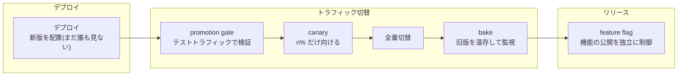
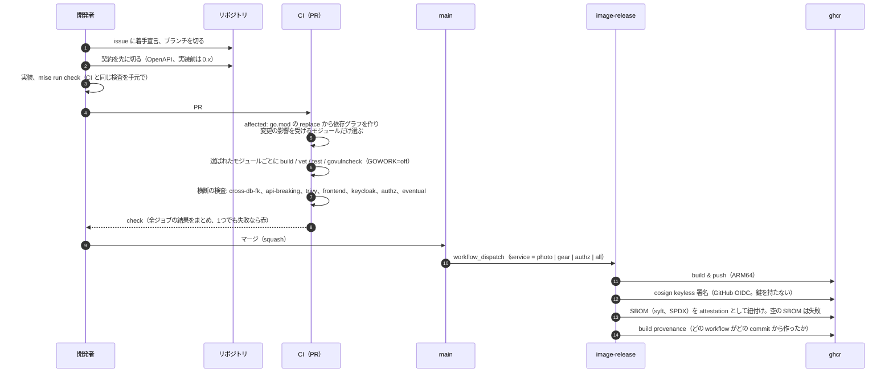
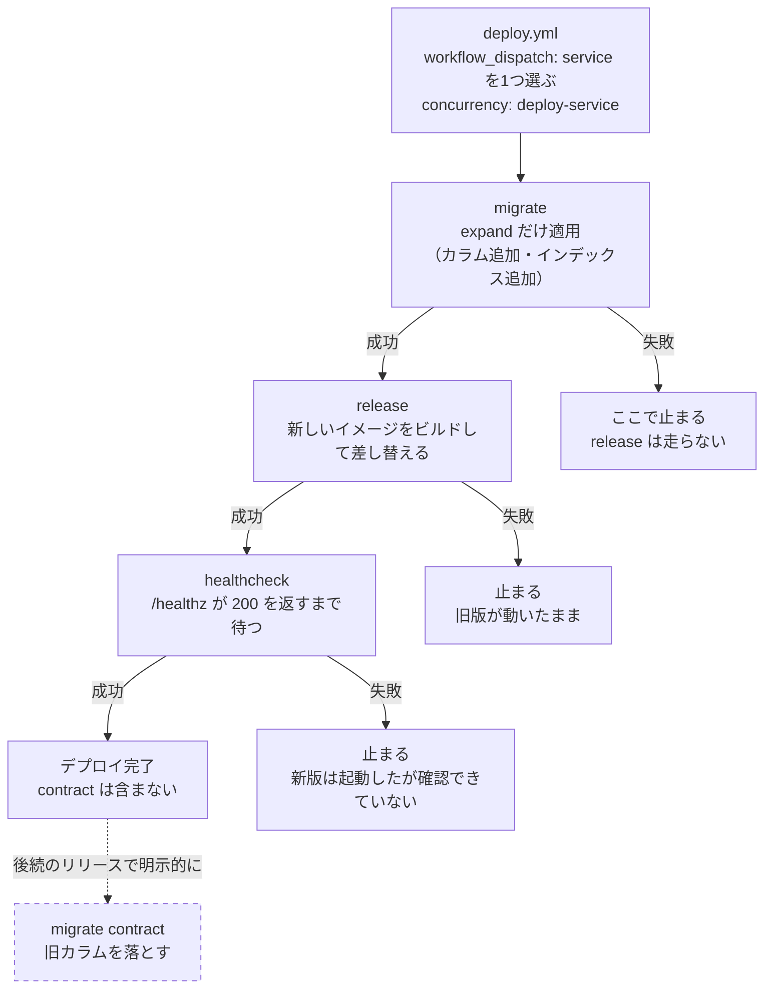
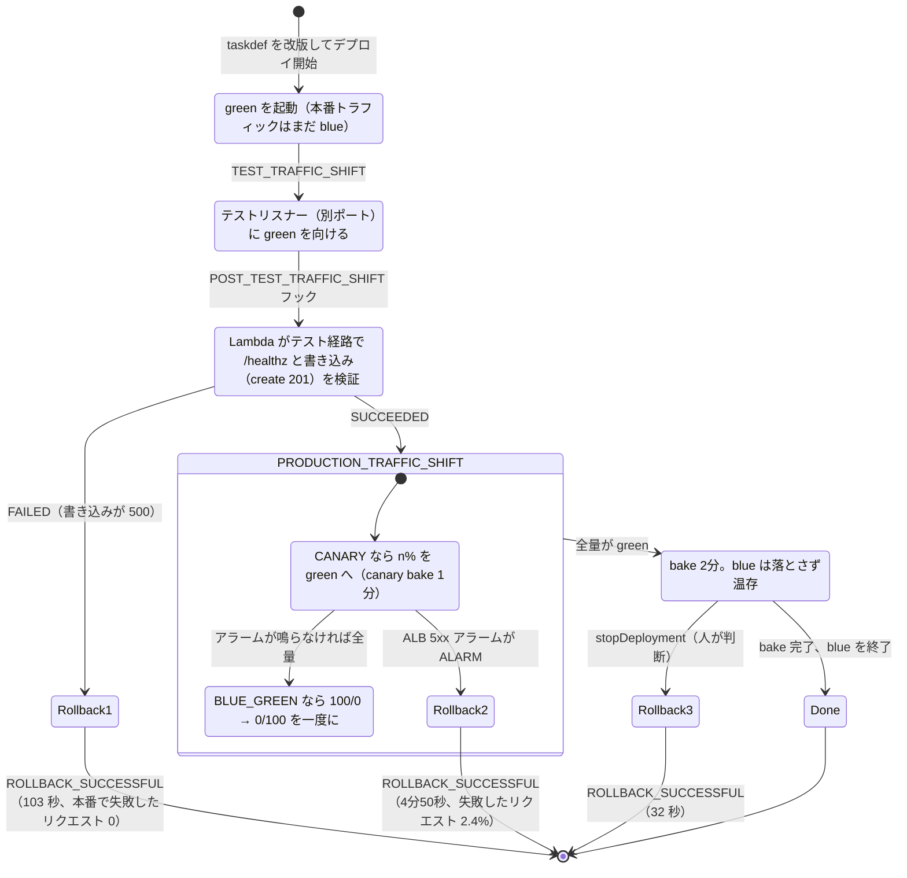
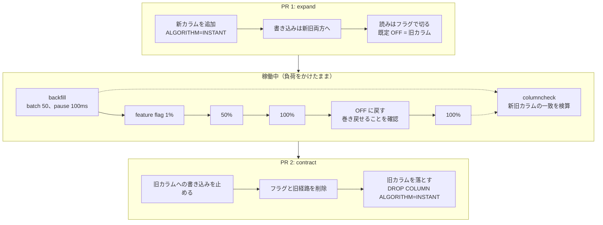
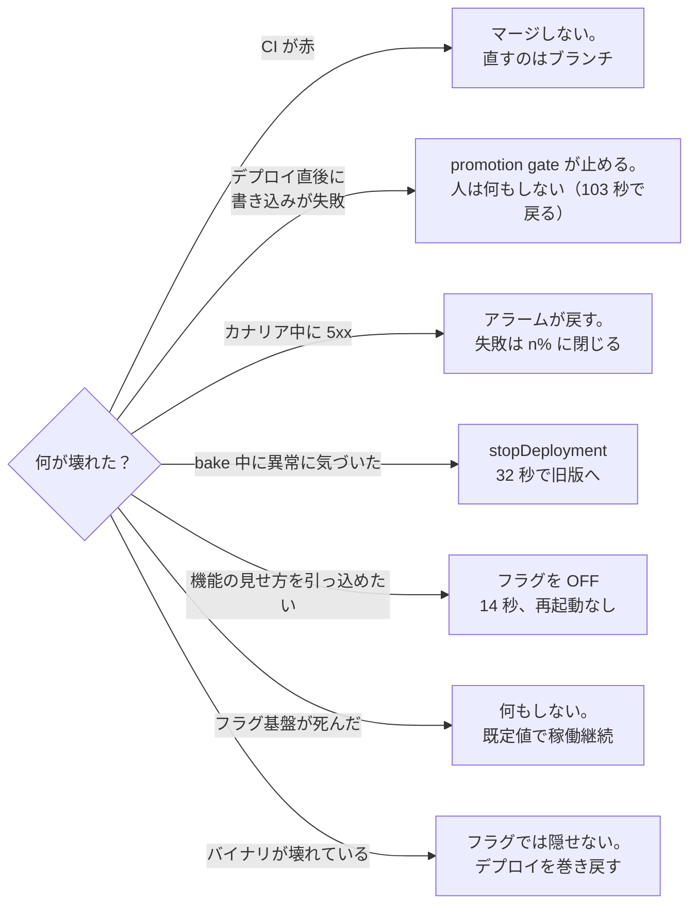

## はじめに

新しいバージョンを本番に出す、という一つの行為に見えるものは、実際には3つの別々の営みでできています。

1. **デプロイ**: 新しいバイナリを本番環境に配置する
2. **トラフィック切替**: 実ユーザーのリクエストをどの版に、どれだけ向けるか
3. **リリース**: 機能をユーザーの目に触れさせるか

一括リリースとは、この3つを同時に、全量で、一発でやることです。うまくいけば速い。失敗すると全ユーザーが同時に影響を受け、戻す手段は「もう一度一括で置き直す」しかない。

**プログレッシブデリバリーは、この3つを分解して、それぞれを段階的・可逆的にする考え方**です。この記事はその全体地図と語彙を整理します。個々の数字は検証環境（Go + ECS + MySQL/Aurora）で実測したものです。

## デプロイの流れ: 変更が本番に配置されるまで

3つの営みのうち最初のデプロイは、語彙より手順そのものが要になる。検証リポジトリ
[greenfield](https://github.com/rikukaInoue/greenfield) で回しているフローを、
開発の流れから順に図で追う。数字はすべて実測で、出典は各節に書く。

### 開発の流れ: PR から署名済みイメージまで

デプロイの前に、変更がどう main に入り、どう配布物になるかを追う。
greenfield は複数のサービスを1つのリポジトリで持つので、
「変更したサービスだけが検査され、配布される」ことが開発の流れの要になる。

図から読み取れないこと。

- **契約を先に切る**のは、実装の前に API の形を固定するためである。ただし実装が
  入っていない契約を `1.0.0` にすると、最初の実装で 200 → 201 に変えただけで破壊的
  変更として止まる（実際に止まった。ADR 0007）。実装前は `0.x` で切り、最初の実装が
  入った時点で `1.0.0` にする
- **affected** は手書きの対応表を持たない。各モジュールの `go.mod` にある相対パスの
  `replace` から依存グラフを作る。実測では 9 モジュール中 2 個だけが動き、docs だけの
  変更は 20 秒で終わる（[デプロイ分離はなぜ開発生産性を上げるのか](/blog/deploy-isolation-developer-productivity/)）
- **手元の `mise run check` と CI は同じ検査**で、CI でしか落ちない検査を作らない。
  ただし CI は `GOWORK=off` で1モジュールずつビルドするので、ワークスペースモードで
  通ってしまう越境 import は CI でだけ止まる（それが CI の存在理由の一つ）
- **イメージの署名と SBOM は配る側の適応度関数**で、検証は `cosign verify-blob` と
  `gh attestation verify` で「このリポジトリのこのワークフロー由来」であることを確かめる。
  通らなければジョブが落ちる

### デプロイの3段: expand → release → healthcheck

デプロイは3段で、**順序を守らせるのはスクリプトではなくジョブグラフ**である。
`dev/scripts/deploy.sh <service> migrate|release|healthcheck` は1段ずつしか実行せず、
`deploy.yml` の `needs` が順序を強制する。3段を1つのスクリプトにまとめると
「migrate が落ちたのに続きが走らないこと」の保証がスクリプトの制御フロー、
つまり読む人の信頼になる。ジョブグラフに置けば、保証は CI の実行機構そのものになる。

図から読み取れないこと。

- **migrate は expand だけ**を適用する。contract（旧カラムを落とす）はデプロイに
  含めず、旧版が消えた後の後続リリースで明示的に実行する。新旧のバイナリが同時に
  動く時間があるので、その間はどちらも動くスキーマでなければならない
  （[アプリと DB でプログレッシブは別物](/blog/progressive-delivery-app-vs-db/)）
- **concurrency はサービス単位**で、同じサービスへの連続デプロイは直列になる。
  別サービスのデプロイは並列に走ってよい。これが「サービスごとに独立してデプロイ
  できる」の実体である
- **expand の DDL は `ALGORITHM=INSTANT` で通るかを先に判定**する。通らない方式は
  エラーで返り、知らずにテーブル全体のコピー（2M 行で 56 秒）に入ることがない
- ECS 上では release の中身が次の節のトラフィック切替そのものになる。compose 上
  （ローカル・CI）では新しいコンテナへの差し替えで、切替の段階はない

## トラフィック切替の語彙

トラフィック制御の部品は4つ覚えれば足ります。

| 語彙 | 何か | 何を守るか |
|---|---|---|
| **Blue/Green** | 新旧2系統を並走させ、ロードバランサの向き先を一斉に掛け替える | 切替そのものの無停止（実測: 切替をまたぐ503リクエストで非200ゼロ） |
| **canary** | まず n% だけ新版に向けて観測し、問題なければ全量へ | 壊れた版の被害を「全量」から「n%」に縮める |
| **promotion gate** | 本番トラフィックを向ける**前**に、テスト用の経路で新版を検証する | テストで再現できる壊れ方の**失敗ゼロ** |
| **bake** | 全量切替の後も旧版を落とさず併走させる監視時間 | 即座に戻れる状態の温存（戻すのはLBの向き先変更だけ） |

大事なのは、これらが**代替関係ではなく直列**だということです。同じ「壊れた版」（ヘルスチェックは正常・書き込みだけ 500 を返す）を流して測った失敗数がそれを示します。

| 構成 | 失敗したリクエスト |
|---|---|
| promotion gate あり | **0 / 1,679**（ゲートが本番前に捕捉、103秒で自動ロールバック） |
| ゲートなし、カナリア20% + アラーム | **69 / 2,880（2.4%）**（検知窓の間に流れた分は失敗する） |

この対比が入門で一番伝えたい数字です。**カナリアは失敗を消しません。** カナリア中に新版へ流れたリクエストは、新版が壊れていれば失敗します。カナリアの価値は「全量事故を n% の事故に縮める」ことであり、失敗をゼロにするのはその手前のpromotion gateの仕事です。

### 流れ: ECS ネイティブ B/G の中で何が起きるか

ECS の B/G デプロイは、デプロイ1回の中に promotion gate・canary・bake・rollback が
全部入っている。1回のデプロイが辿る状態を追う。

同じ「壊れた版」（ヘルスチェックは正常、書き込みだけ 500）を流して測った結果を
並べる。

| 止めた場所 | 仕組み | 本番で失敗したリクエスト | 戻るまで |
|---|---|---|---|
| promotion gate | フック Lambda がテスト経路で書き込みまで検証 | **0 / 1,679** | 103 秒（自動） |
| カナリア窓 | 20% を流し、ALB 5xx アラームで自動ロールバック | **69 / 2,880（2.4%）** | 4分50秒（自動） |
| bake 中 | 人が `stopDeployment` を1回発行 | 0 / 2,399（健全な版） | 32 秒 |

図から読み取れないこと。

- **ゲートは healthz だけでは足りない。** `/healthz` は 200 を返しながら書き込みだけ
  壊れている版は、healthz 検査だと素通りする。フックは `POST /photos` で 201 が返る
  ところまでやる。ただし commit はしない。残るのは実体オブジェクトの無い
  `pending_upload` の行だけで、未完了分の回収ジョブが削除する対象に収まる。
  フックを commit まで深くすると、健全なデプロイのたびに回収対象から外れたデータが
  本番に残る
- **フックの判定ロジックは単体テストで固定している。** ゲートは壊れると「全デプロイ
  を止める」か「壊れた版を通す」の両極に倒れる。インラインのスクリプトではなく
  ファイルとして持ち、回帰テストを付けた
- **BLUE_GREEN と CANARY は ECS 上で別の strategy**で、API が排他を強制する。
  Terraform の provider はこの無効な組み合わせを黙って受理してカナリア設定を落とした
  （fail open）。だからフックやアラームの取り付けは API で行い、効いたかはデプロイの
  挙動で確認する
- **アラームの 4分50秒はメトリクス集計の 60 秒と ALB 計測の遅延がほとんど**で、
  アラームが鳴った同じ秒に ROLLBACK_IN_PROGRESS に入っている。縮めるにはカナリアの
  手前のゲートで捕まえるしかない
- **stopDeployment の 32 秒はターゲットグループの掛け替えの速さ**で、bake 中は旧
  タスクが生きているので、ロールバックはルールの向き先変更だけで済む。bake を長く
  取るほど、この速さで戻れる時間が長くなる

## リリースの語彙: フィーチャーフラグ

デプロイと切り離して機能の公開を制御するのがフィーチャーフラグです。コードはデプロイ済みだが、フラグが無効ならリリースされていない — この分離により、機能の公開・撤回がデプロイなしでできます。

実測では、フラグ反転がユーザーに届くまで **14秒・再起動なし**でした。デプロイの巻き戻し（後述の `stopDeployment`、32秒）と並ぶ、もう1つの巻き戻し手段です。

ここでの誤解も正しておきます。「フラグの方が速いなら、事故対応は全部フラグでいいのでは」— なりません。**フラグで隠せるのは、コードが正しく動く前提での見せ方だけ**です。壊れたバイナリはフラグの後ろでも壊れ続けます（ログとリソースを汚しながら）。バイナリの問題はデプロイの巻き戻しで、見せ方の問題はフラグで戻します。2つの手段を独立に保つから、どちらも迷わず使えます。

| 事象 | 対処 | 実測 |
|---|---|---|
| バイナリが壊れていた | デプロイの巻き戻し（`stopDeployment`） | 32秒で本番復帰 |
| 機能の見せ方を引っ込めたい | フラグ反転 | 14秒で全ユーザーへ |
| フラグ基盤自体が死んだ | 何もしない | コードに宣言した既定値で稼働継続 |

3行目も設計の一部です。フラグの既定値は「フラグ基盤が死んだときの安全側」を宣言する場所で、これを決めてあればフラグ基盤の障害がサービス停止に化けません。

### 流れ: feature flag → backfill → contract

デプロイもトラフィック切替も終わって新版が全量で動いていても、機能はまだ
リリースされていなくてよい。リリースはフラグで、デプロイとは別の時刻に、別の
手段で行う。カラム改名を例に、リリースの流れを DB の変更と一緒に追う。
これは greenfield の `rename-drill.sh` が負荷をかけたまま自動で回す手順である。

図から読み取れないこと。

- **書き込みは常に両方、フラグで切るのは読みだけ。** これにより、フラグをどの割合に
  しても、どちらのカラムも常に正しい値を持つ。巻き戻しは読み先を戻すだけで済み、
  データの修復が要らない
- **フラグの反転は 14 秒で全ユーザーに届き、再起動は無い。** ローカルは flagd の
  flag sync、AWS は AppConfig で、どちらも定義を同期してプロセス内で評価する。
  フラグ基盤が落ちても、コードに宣言した既定値で動き続ける
- **「OFF に戻す」を本番手順に含める**のは、巻き戻せることを巻き戻す前に確かめる
  ためである。100% にしてから初めて OFF を試すと、そのときが最初の巻き戻しになる
- **columncheck が一致 100% を出さなければ contract に進まない。** 期待はリクエスト
  エラー 0 件と新旧カラム一致 100% で、前提（フラグ定義・両カラムの存在・バック
  フィルコマンド）が欠けていればドリルは何も実行せずに失敗する。空振りしたまま成功と
  報告しない
- **3つの PR に割る**（expand / 切替 / contract）のは、各段を独立にレビューし、
  独立に戻せるようにするためである。詳しくは
  [モノレポの無停止移行とデプロイ分離](/blog/online-migration-and-deploy-isolation/)

## N-1 互換性 — DB は徐々に切り替えられない

ここまでのトラフィック切替の話はすべて、**N-1 互換性**という前提の上に立っています。新旧1世代差のバイナリが同時に正しく動けること — B/G もカナリアも bake も、**新旧のバイナリが同時に動く時間**を作るからです。トラフィックは 20% と 80% に割れますが、**データベースのスキーマは1つしかありません**。新旧両方のバイナリが、同じスキーマで正しく動く必要がある。

つまりアプリ層のプログレッシブデリバリーは、DB 層に「新旧互換なスキーマ変更」という別種の規律を要求します。トラフィックのように割合で割る話ではなく、**時間で分ける**話（互換を保って先に広げ、旧版が消えてから縮める）になる — この非対称性は1本の記事に値するので、[アプリと DB でプログレッシブは別物](/blog/progressive-delivery-app-vs-db/)として続編に分けました。

## まとめ

- プログレッシブデリバリー = 「デプロイ・トラフィック切替・リリース」を分解し、それぞれを段階的・可逆的にすること
- トラフィック切替の部品（promotion gate → canary → bake）は直列であり、守るものが違う。**canary は失敗を消さない**（0/1,679 vs 69/2,880）
- 巻き戻しの手段は2つ（デプロイ32秒 / フラグ14秒）。速さでなく**管轄**で使い分ける
- すべての前提は N-1 互換性。トラフィックは割合で割れるが DB のスキーマは割れないので、ここから先は層ごとに別の話になる

続編: [アプリと DB でプログレッシブは別物](/blog/progressive-delivery-app-vs-db/)（各層の仕組みと実測）、[選び方、そして選ばせない運用](/blog/deploy-strategy-selection/)（組み合わせの運用）

### 全体の流れ

ここまでの節で追ったフローを1枚に並べる。縦に4つの営みが並び、左から右へ時間が進む。

```mermaid
flowchart LR
    subgraph dev["開発"]
        D1["issue に着手宣言"] --> D2["契約を先に切る<br/>OpenAPI 0.x"] --> D3["実装 + mise run check"] --> D4["PR → CI<br/>変更モジュールだけ"] --> D5["マージ → image<br/>署名 + SBOM"]
    end
    subgraph deploy["デプロイ"]
        P1["migrate<br/>expand だけ"] --> P2["release<br/>新タスク起動"] --> P3["healthcheck"]
    end
    subgraph traffic["トラフィック切替"]
        T1["promotion gate<br/>テスト経路で書き込み検証"] --> T2["canary n%"] --> T3["全量切替"] --> T4["bake<br/>旧版を温存"]
    end
    subgraph release["リリース"]
        R1["feature flag 1% → 50% → 100%"] --> R2["OFF で巻き戻せるか"] --> R3["旧経路の削除"] --> R4["contract<br/>旧カラムを落とす"]
    end
    D5 --> P1
    P3 --> T1
    T4 --> R1
```

4つの営みはそれぞれ独立した巻き戻しの手段を持つ。デプロイは
`stopDeployment`、トラフィックはターゲットグループの向き先、
リリースはフラグの反転で、どれも他を動かさずに戻せる。

### 失敗したときの対処: 何が壊れたかで決まる

4つの営みを分けた最大の利点は、何が壊れたかによって対処が決まることである。

最後の2行が分離の意味を言っている。フラグで隠せるのはコードが正しく動く前提での
見せ方だけで、壊れたバイナリはフラグの後ろでも壊れ続ける。バイナリの問題は
デプロイの巻き戻しで、見せ方の問題はフラグで戻す。2つの手段が独立しているから、
どちらも迷わず使える。
