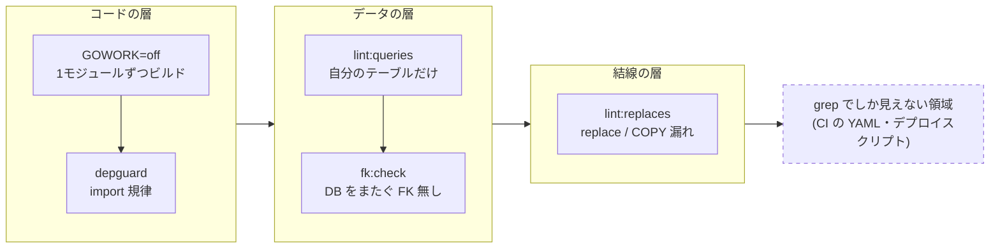

設計の意図は、文書に書いても人数と時間で薄まる。守りたい性質を機械で測り、
外れたら止める仕組みが**適応度関数**（fitness function）で、進化的アーキテクチャが
「変化を止めずに形を保つ」ために置く唯一の手段がこれになる。

この記事は、検証リポジトリ [greenfield](https://github.com/rikukaInoue/greenfield)
で実際に CI に常設している検査を例に、何を・なぜ・どう書くかをまとめる。
進化的アーキテクチャの3要素を地図として眺めたい場合は
[入門記事](/blog/evolutionary-architecture-intro/)のほうが向いている。
ここでは3要素のうち適応度関数だけを掘る。

## 設計は放っておくと崩れる

アーキテクチャは一度決めれば保たれるものではなく、変更のたびに少しずつ別の形へ
動く。進化的アーキテクチャ（Ford・Parsons・Kua『Building Evolutionary
Architectures』、2017）はこれを前提に置く。変化を止めようとするのではなく、
変化しながら守りたい性質だけは外さない、という構えである。

意図が薄まる経路は決まっている。設計者が手を離れる。新しい人が入り、文書を
読まずに既存のコードを真似る。締め切りの前に「今回だけ」の近道が通る。
レビューで指摘しても、指摘した人がいない日に同じ近道が通る。どれも悪意ではなく、
人数と時間がそろえば必ず起きる。

規約文書はこの経路を止められない。文書は読まれた瞬間にしか効かず、違反しても
何も起きないからである。「他サービスの内部を直接 import しない」と書いた規約と、
import したらビルドが落ちる仕組みは、同じ一文に見えて効き方がまったく違う。
前者は人の記憶に頼り、後者は人の記憶に頼らない。

さらに、設計の意図は時間がたつと本人にも分からなくなる。半年前に決めた
「サービス間で外部キーを張らない」の理由を思い出せる人は少なく、理由が分からない
制約は守られない。性質を機械に預けておけば、理由を忘れても形は保たれる。

## 適応度関数とは何か

適応度関数は、アーキテクチャのある性質が保たれているかを客観的に判定する仕組み
である。語は進化計算から来ている。たくさんの候補解の中から「よい」ものを選ぶために、
よさを数値で返す関数をこう呼ぶ。アーキテクチャに持ち込むと、「この変更を入れた
あとのシステムは、守りたい性質をまだ満たしているか」を変更ごとに答える関数になる。

ふつうのテストとの違いは、何を見ているかにある。単体テストは「この関数は正しい値を
返すか」という機能を見る。適応度関数は「サービスは他サービスの内部を知らないか」
「公開 API は後方互換か」「コンテナは非 root で動くか」という構造や運用の性質を見る。
機能はすべて正しくても、こうした性質は壊れていられる。

規約との違いは、読む人がいなくても効くことである。規約は「こうあるべき」を書き、
適応度関数は「こうでなければ通らない」を実行する。役に立つ適応度関数には次の性質が
そろっている。

- 守る性質が1つに決まっている。「品質」のような広い語ではなく、「DB をまたぐ
  外部キーが無い」のように否定できる形で書ける
- 結果が二値である。通ったか落ちたかだけが出て、点数や所感は出ない
- 自動で、変更のたびに走る。CI に置かれ、人が走らせることを覚えていなくても走る
- 落ちたらマージできない。警告を出して通すだけのものは、この記事では「観測」と
  呼んで区別する

測れない性質は守れない。守りたいものを決めることと、それを測る関数を書くことは、
設計の同じ一歩の表と裏である。

## 例1　境界を守る

greenfield は、複数のサービス（photo、gear、authz）を1つのリポジトリで持ちながら、
サービスごとに別々にデプロイできることを検証するプロジェクトである。守りたい性質を
一語で書けば「サービスは他サービスの内部を知らない」になる。モノリポはこの性質を
壊すのがとても簡単で、隣のディレクトリを import するだけで済む。だから境界は
3層で機械が守っている。

**コードの層。** サービスごとに別の Go モジュールにし、CI はワークスペースを切って
（`GOWORK=off`）1モジュールずつビルドする。ワークスペースモードではどのモジュールも
require なしで import できてしまうから、日常の開発では通ってしまった越境がここで
止まる。その上に depguard があり、「表示専用の読みモデル（replicaview）を業務判断に
使わない」「ストレージやフラグの実装は差し込み口からしか触れない」という、
モジュールの内側の規律を import 単位で止める。

**データの層。** コードの境界を守っても、DB が繋がっていればサービスは分けられない。
`lint:queries` は、各サービスの SQL が自分のテーブルだけを触っているかを、
`db/schema.sql` を許可リストにして検査する。`fk:check` は、database をまたぐ外部キーが
無いことを実 DB で検査する。またぐ外部キーが1本でもあると、片方のサービスの
マイグレーションがもう片方のテーブルをロックし、もう片方のデプロイがロック待ち
（MySQL のエラー 1205）で落ちる。「別々にデプロイできる」という性質が、具体的に
何で壊れるかを検査が語っている。

**結線の層。** `lint:replaces` は、モジュール間の require に対応する replace が全部あるかと、
Dockerfile が依存するモジュールをすべて COPY しているかを検査する。ビルドは通るのに
イメージだけが壊れる、という穴を埋める。

この3層がどこまで効くかは、サービスを1つ消すドリルで実測している
（[境界の引き直しは楽にできるのか](/blog/boundary-redraw-cost-measured/)）。
gear を `git rm` してワークスペースから外すと、65ファイル・4,135行が消える。
コードに残った参照はこの3層が全数をエラーとして列挙し、追従漏れが緑のまま滑り込む
余地はなかった。一方で、CI の YAML やデプロイスクリプトに残った34ファイル・
約230箇所の参照は、grep でしか見つからなかった。適応度関数は射程の中では強く、
射程の外は見ていない。その射程を実測で知っておくことも、関数を書くことと同じくらい
大事である。

## 例2　契約を守る

公開 API の後方互換は、「注意してレビューする」で守れるものではない。必須項目を
1つ足す、ステータスコードを 200 から 201 に変える、という小さな変更が利用側を壊す。
greenfield では huma から生成した OpenAPI を `api/` に置き、`api:breaking` が毎 PR で
`origin/main` のスペックと比較する。守る性質は「既存の利用側は、何もしなくても
動き続ける」である。

最初の版は「破壊的変更があるのにメジャーを上げていなければ落とす」だけだった。
これには穴があった。メジャーを上げて同じファイルを書き換えれば、旧版を消して
置き換えても CI が通る。「メジャーを上げた」と「旧版を提供し続けている」は別の性質で、
前者だけを測っていた。ADR 0017 で次のように組み直した。

- ファイル名とメジャーを1対1に結ぶ。`<listener>.openapi.json` はメジャー1、
  `<listener>.v2.openapi.json` はメジャー2で全パスが `/v2/` 配下。`info.version` と
  食い違えば落ちる
- 既存ファイルへの破壊的変更は、メジャーを上げても通さない。破壊的変更は次の
  メジャーのファイルとして足すしかない
- 新しいメジャーは、一つ前のメジャーが残っているときだけ足せる（並行提供の強制）
- 旧版のファイルを消せるのは、main で全操作が `deprecated` のときだけ（廃止予告の
  リリースを1回挟む）

この検査が設計をも形作った点が面白い。「破壊的変更は別ファイルで」を強制すると、
v2 は自然と「同じ usecase につながる別のアダプタ」になる。バージョンを持つのは
handler だけで、usecase と domain は持たない。旧版の廃止はアダプタ1つとスペック
1ファイルの削除で済み、業務ロジックに触れない。適応度関数は守るだけでなく、
守りやすい形へ設計を寄せる。

`api:breaking` は比較ができなかったときも失敗する。比較器が動かなければ「破壊的変更
なし」とは言わないし、全スペックが新規扱いになったらゲートが空振りしている印として
落とす。この決め方は後の章でもう一度出てくる。

## 例3　守りの既定値

「コンテナは非 root で動かす」「RDS は保存時暗号化を有効にする」「秘密を taskdef の
environment に平文で置かない」。どれもセキュリティの規約として書かれがちで、
どれも1行の差分で静かに破れる。greenfield では `lint:secure-defaults` が3つを
機械で守る。

1. 全 Dockerfile の最終ステージに `USER` がある
2. 全 `aws_db_instance` / `aws_rds_cluster` に `storage_encrypted = true` がある
3. Terraform の `environment` ブロックに `db_password` / `devtoken` を参照する行が無い

この検査には2つの決め事がある。1つは、**走査対象が0件なら失敗する**こと。Dockerfile
が1つも見つからなければ「USER の無い Dockerfile は無かった」ではなく「検査が成立して
いない」と判定する。もう1つは、**3ルールとも変異で落ちることを確認してから入れた**
こと。USER を削除する、`storage_encrypted` を消す、平文の秘密を戻す、という変更を
実際に当てて、検査が落ちるのを見てから CI に置いた。

後者はテストのテストに相当する。検査を書いたとき、それが本当に悪い変更を捕まえるかは
書いた本人にも分からない。正規表現が1文字ずれていれば、何も捕まえない検査が
緑のまま常設される。壊してみせて落ちることを見る、という手順を省くと、適応度関数は
守っているつもりの飾りになる。

## 例4　依存の脆弱性

依存の脆弱性検査は、適応度関数の中でもっとも「続くかどうか」が問われる領域である。
Trivy は同じ CVE を同じ数、毎日出す。人間は3回目から見なくなり、その瞬間から
その CI ジョブは緑でも赤でも意味の無い飾りになる。

greenfield はこれを**差分運用**で解いた（ADR 0021）。基準（baseline）を固定し、
新規に出たものだけを失敗にする。除外には理由と期限を必ず書き、期限切れは失敗にする。
理由の無い除外は半年後に誰も外せなくなり、期限の無い除外は永久に膨らむ。新規が
0件なら静かに緑で、新規が出たときだけ落ちて目に入る。baseline ファイルが無ければ
失敗、検出0件なのに baseline に件があれば検査の空振りとして失敗。層の切り方は
[継続的脆弱性検査は層で回す](/blog/continuous-vulnerability-scanning/)に書いた。

この仕組みが意図どおり働いた実例が、この記事を書いている週にあった。10月6日から
main の CI と夜間の検査が落ち続けた。コードは何も変わっていない。原因は3つで、
すべて上流の脆弱性 DB の更新だった。

| 検査 | 検出 | 修正 |
|---|---|---|
| govulncheck | Go 1.26.6 の標準ライブラリに8件（`net/http`・`crypto/tls` など） | ツールチェーンを 1.26.9 へ |
| Trivy（イメージ） | `golang.org/x/net` v0.58/v0.59 の HTTP/2 DoS、続いて `google.golang.org/grpc` v1.83.1 の DoS | 5モジュールで x/net v0.60.0、3モジュールで grpc v1.84.0 へ |
| osv-scanner | 開発依存 `source-map-js` 1.2.1 の DoS（vite 経由） | lockfile を 1.2.2 へ |

直したのは go.mod・lockfile・ツールのバージョン指定だけで、baseline への例外追加は
していない。修正版が出ているなら上げるのが筋で、例外は「今は直せない理由と期限」が
あるときに書くものだからである。

ここで効いていたのは3つの決め事である。検査が fail closed だから、何も変えていない
PR でも止まった。差分運用だから、止まった原因が新規の3件に絞られて読めた。
govulncheck が到達性つきだから、「依存に CVE がある」ではなく「自分のコードが呼ぶ
経路にある」ものだけが出た。grpc は直接使っておらず OTel のエクスポータ経由の間接
依存だったが、イメージ検査が実物のバイナリを見ているので捕まった。

## fail closed と、検査の検査

ここまでの例に繰り返し出てきた決め事を、まとめて書く。

**空振りを成功にしない。** `api:breaking` は比較できなければ失敗する。
`secure-defaults` は走査0件なら失敗する。baseline 運用は baseline ファイルが
無ければ失敗する。検査は壊れると、失敗ではなく成功として出てくる。入力が空になった、
対象のディレクトリ名が変わった、ツールのバージョンが上がって出力形式が変わった。
どれも「検出0件」として緑になる。この壊れ方は
[fail open](/blog/checks-fail-open/) として別の記事に分類と技法をまとめたが、
適応度関数を書くときの最重要の罠はこれである。

**ゲート自身を壊して確かめる。** `secure-defaults` の3ルールは変異で落ちることを
確認した。`api:breaking` には `api:breaking:test` が、baseline の共通機構には
`baseline:test` があり、「破るべき形を正しく落とすか」を検査する。どちらも
`mise run check` に含まれ、毎 PR で走る。

**定期的に点検する。** 四半期ごとに `audit:checks` が、検査ツール自身の回帰テストを
一括で回す。「ずっと成功し続けている検査」こそ疑う対象で、半年間赤くなったことの
無い検査は、守っているのか見ていないのかを区別できない。

## 失敗にしないものの判断

すべてを失敗にすると、今度は別の壊れ方をする。greenfield には意図して警告に留めて
いる検査が2つある。

`lint:drift` は、複数のモジュールが共有する依存（x/net や grpc）のバージョンが
ずれていないかを観測する。これを失敗にすると、依存を更新する PR が片側のモジュール
から通せなくなる。dev と photo だけ上げた PR は、残りが古いので落ちる。全部を1つの
PR で上げることを強制すればよいが、それは Dependabot の PR の粒度と合わない。
だから警告のみ（exit 0）で、締めるときは `-strict` を付ける。上の CVE の例では、
まさに x/net が v0.58 と v0.59 に割れていたのをこの観測が示していた。

`fk:report` は、DB をまたぐ外部キーの検査（`fk:check`）の警告モードである。
モノリスからサービスを切り出す移行の途中では、またぐ外部キーが何本も残っている
のが正常な状態で、それを失敗にすると移行中は CI が常に赤になる。だから移行中は
「あと何本切れれば独立か」を進捗として出し、切り出しが終わった時点で失敗モードに
切り替える。

線引きの基準はこうなる。性質が壊れたら即座にマージを止めるべきものは失敗にする。
性質に向かう途中の状態を見たいもの、または失敗にすると正しい変更が通らなくなる
ものは観測にする。観測は適応度関数ではないが、適応度関数をいつ締めるかを決める
材料になる。

## 一覧

greenfield で常設している検査を、守る性質ごとに並べる。頻度の「毎 PR」は
`mise run check` と CI の両方で走るもの、「日次」は夜間の security ワークフロー。

| 守る性質 | 検査 | 落ち方 | 頻度 |
|---|---|---|---|
| サービスは他サービスの内部を知らない | `GOWORK=off` ビルド、depguard | 失敗 | 毎 PR |
| SQL は自分のテーブルだけを触る | `lint:queries` | 失敗 | 毎 PR |
| DB をまたぐ外部キーが無い | `fk:check`（移行中は `fk:report` で観測） | 失敗 / 警告 | 毎 PR |
| 結線漏れが無い | `lint:replaces` | 失敗 | 毎 PR |
| 生成物がソースと一致する | `sqlc:check`、`schema:check`、`api:check`、`client:check` | 失敗 | 毎 PR |
| 公開 API は後方互換 | `api:breaking`（ADR 0017） | 失敗。比較不能も失敗 | 毎 PR |
| 非 root、保存時暗号化、平文の秘密なし | `lint:secure-defaults` | 失敗。走査0件も失敗 | 毎 PR |
| アラートルールが意図どおり発火する | `lint:alerts`（promtool） | 失敗 | 毎 PR |
| 到達可能な依存の CVE が無い | govulncheck | 失敗（baseline なし） | 毎 PR + 日次 |
| 新規の既知脆弱性が無い | osv-scanner + pnpm audit、Trivy（設定・イメージ） | 新規のみ失敗。除外は理由と期限必須 | 毎 PR + 日次 |
| 共有依存のバージョンがそろっている | `lint:drift` | 警告のみ | 毎 PR |
| 検査自身が壊れていない | `api:breaking:test`、`baseline:test`、`audit:checks` | 失敗 | 毎 PR / 四半期 |

## 書くときの指針

最後に、ここまでの例から取り出せる指針を並べる。

1. **性質から書く。** 「lint を入れる」ではなく「何が保たれていてほしいか」を一文で
   書き、それを否定できる形にしてから検査にする。性質が書けないなら、まだ何を守り
   たいのか決まっていない
2. **結果は二値にする。** 点数やスコアは読まれなくなる。通るか落ちるかだけにし、
   途中の状態を見たいなら観測として別に置く
3. **fail closed にする。** 入力が空、比較不能、走査0件は失敗にする。「検出0件」と
   「検査していない」を同じ緑にしない
4. **ノイズは差分運用で飼う。** 毎回同じ検出が出る検査は、基準を固定して新規だけを
   失敗にする。除外には理由と期限を書く。ノイズの無い検査（govulncheck や自前の
   テスト）まで緩める理由にはしない
5. **ゲートを壊して確かめる。** 入れる前に、守りたくない変更を実際に当てて落ちるのを
   見る。入れた後も、定期的に同じことをする
6. **射程を実測で知る。** 検査が見ている範囲と見ていない範囲を、実際に壊して確かめて
   おく。見ていない範囲は、別の検査を足すか、見ていないと明記する

適応度関数は、設計の意図を人の記憶から機械へ移す作業である。人が覚えていなくても、
理由を忘れても、締め切りの前でも、同じ判定が同じように出る。進化的アーキテクチャが
「変化を止めずに形を保つ」と言えるのは、この移し替えができているときだけである。
